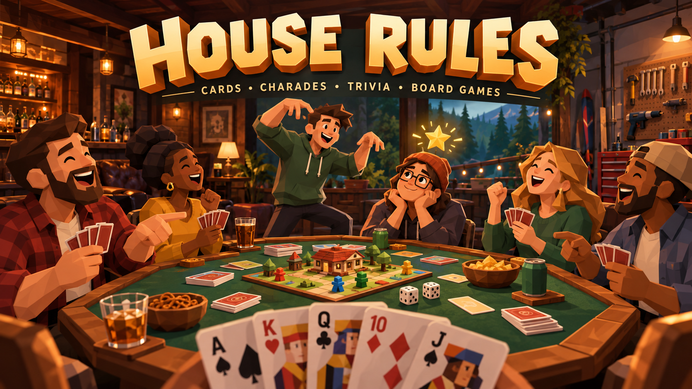

# House Rules

Your table. Your rules. A browser-based game night for friends.

## Contents

1. [About House Rules](#about-house-rules) — what the game-night website does.
2. [How to run](#how-to-run) — Windows launcher and terminal setup.
3. [Play with friends](#play-with-friends) — local Wi-Fi, internet access, [spectators](#spectators) and [shared music](#shared-music).
4. [Available games](#available-games) — all 15 presets and player counts.
5. [Game guides](#game-guides) — setup, controls and scoring.
6. [Rules](#rules) — [house settings](#house-settings), [chaos overview](#chaos-rule-overview), [compatibility](#compatibility-at-a-glance), [per-game effects and die faces](#full-rule-effects-and-die-faces-by-preset), and [timing safeguards](#timing-penalties-and-limits).
7. [Development](#development) — editing, building and testing.
8. [Architecture](#architecture) — source layout and multiplayer design.
9. [Verification](#verification) — automated and browser checks.
10. [Release history](#release-history) — earlier updates and implementation notes.

## About House Rules

**House Rules** is a self-hosted, browser-based TypeScript game-night sandbox for friends. One person runs the server, hosts a room and chooses a game; everyone else joins through a browser with an invite or room code. The host can customize supported rules and add optional chaos modifiers that change real cards, scores, chips, turns and other game resources.

The website includes **15 game presets**, a low-poly 3D table, animated avatars, first- and third-person cameras, private hands, shared chat, action sounds, shared music and seven backgrounds. Trivia contains 1,000 questions across ten categories; pair Charades contains 1,900 prompts across 19 categories. Restart, early ending and lobby controls keep the group in control of the session.

It runs from your machine and uses a persistent Node.js/WebSocket server for live rooms. Rooms exist in memory and disappear when the server stops. Use your existing group call for voice or video. Written house agreements are notes for the group; supported toggles and parameters drive the automated behavior.



## How to run

Requires **Node.js 22.12 or newer**. Run commands from the project folder.

### Windows launcher

Double-click **Start House Rules.cmd**. It uses the installed Node.js runtime (or the bundled Codex runtime), installs missing dependencies, builds if necessary and starts the server. Keep its terminal open while playing; press **Ctrl+C** to stop.

### Terminal setup

```powershell
npm install
npm run build
npm start
```

Open [localhost:3000](http://localhost:3000), choose a preset and configure the house rules, enter your name and click **Host a table**. Invite friends, then start once the required players have joined. The ready check is a courtesy indicator; the host can start when enough people are present.

Build again after pulling source updates, then restart the server and refresh each browser. Restarting the server clears existing rooms. For source editing and hot reload, see [Development](#development).

## Play with friends

### Same Wi-Fi

The server prints your local network address, such as `http://10.0.0.99:3000`. Friends open that address on their phones or computers. Share the invite link **from this network address**, since a `localhost` invite only works on the host computer. If Windows Firewall asks, allow Node.js on your trusted private network. The server listens on port 3000 on all interfaces.

### Different homes

Use a private VPN connection such as [Tailscale machine sharing](https://tailscale.com/docs/features/sharing), or a WebSocket-capable HTTPS tunnel to local port 3000. A room code by itself does not make your computer reachable across the internet. With a private network, share the host computer's private-network IP and port 3000; follow the provider's access setup. This project has no built-in hosting account, tunnel, or matchmaking service.

**Cloudflare Tunnel:** with House Rules running on port 3000 and `cloudflared` installed, open a second terminal and run:

```powershell
cloudflared tunnel --url http://localhost:3000
```

Share the public HTTPS URL printed by `cloudflared` with your friends. Open the game through that URL before copying room invites so they use the public address. Keep both the game server and tunnel terminals running while playing.

Use it with trusted friends. Room codes are lightweight invite gates, not account authentication. No router or firewall changes have been made automatically. For an internet deployment, put the server behind HTTPS and authentication rather than exposing HTTP directly.

### Spectators

Enter a name and room code (or open an invite), then choose **Watch as spectator**. Up to **32 spectators** can join a lobby, full table or game already in progress without consuming player seats or changing teams, deals, votes or scoring. They see the public table and shared drawing canvas/questions, with no private hands, hidden roles, unrevealed answers or acting prompts.

During a game, spectators can use two reactions:

| Reaction | Behavior | Cooldown |
| --- | --- | --- |
| 🍅 Throw tomato | Choose a seated player; a polygon tomato arcs toward them and splats with a sound. | 8 seconds per spectator |
| 👻 Ghost dance | Become a translucent ghost in the center of the table for 6 seconds. Shuffle or disco, with a 20% chance of a surprise twerk. Includes dance sounds. | 45 seconds per spectator |

One ghost can occupy the dance floor at a time. Both cooldowns are enforced by the server and survive reconnecting, leaving/rejoining with the same session, restarts and Time Warp. Reactions affect only presentation. Spectators cannot play cards, guess for points, vote, change rules or trigger chaos modifiers. They can chat, except during an active Werewolf game, when the audience stays silent.

Non-host players can choose **Watch instead** in the lobby; spectators can **Join as player** when a seat opens. Roles stay fixed during a match, and the host keeps a player seat. Spectators may leave at any time. The host can expand **Audience** to remove a spectator during a game or in the lobby.

### Shared music

Click **♫ Music** beside **Sound on/off** to open the room jukebox. Search for a song, artist or mood and choose **+ Queue**. Any connected room member, including spectators, can contribute songs and use **Play**, **Pause**, **Restart song** or **Skip**; these controls affect the room. The first added song starts automatically, queued tracks play in order, and up to 30 songs can wait in the queue. Players can remove their own queued songs; the host can remove anyone’s queued entry.

**Volume · only you** controls a separate music player in your browser and is remembered locally. Setting it to zero silences music for you without changing other players’ volume or the shared playback. The existing Sound button controls game effects separately. Closing the modal keeps music playing. If a browser blocks autoplay, open Music and tap **Enable music on this device**. Anyone connected to the server can search, including visitors before joining a room and spectators. Before joining a table, **+ Queue** starts a personal listening queue with working play, pause, skip, restart and removal controls. These songs play only for you. Joining a table clears the personal queue and switches to that room’s shared music; it does not silently broadcast your personal picks. Spectators can also contribute to and control the shared music queue.

Playback follows a server timeline, including for late joins and reconnects; browsers correct noticeable drift. Network buffering can cause small timing differences. Disconnecting pauses that client until it reconnects, and leaving a room stops its local player. The queue continues through games, lobby changes, restarts and Time Warp. Server shutdown clears the queue with the other in-memory room data.

Music uses a host-configured **Invidious or Piped** instance for search and audio streaming. There is no hardcoded public instance, public-instance rotation, YouTube API key requirement or automatic fallback to the official YouTube player. Native audio stays separate from game effects and keeps playing when the modal closes. Use **Seek · shared playback** to change the song position for everyone.

**Required host setup:** copy `.env.example` to `.env`, choose a backend, and supply its API base URL:

```dotenv
MUSIC_PROVIDER=invidious
MUSIC_API_URL=http://127.0.0.1:3001
MUSIC_STREAM_ORIGINS=
```

For Piped, set `MUSIC_PROVIDER=piped` and use the **backend API** URL, not its frontend page. The URL above is an example, not an included running service. A working instance must be installed separately or provided by the host. For Windows self-hosting, follow the maintained [Invidious installation guide](https://docs.invidious.io/installation/) (Docker Desktop/WSL and Invidious Companion) or [Piped self-hosting guide](https://docs.piped.video/docs/self-hosting/). Docker or an instance is not installed automatically by House Rules. Restart the game server after editing the configuration.

If the instance serves audio through a separate companion/proxy origin, add that exact trusted origin to `MUSIC_STREAM_ORIGINS`, separated by commas for multiple origins. The configured API origin and HTTPS YouTube media CDN subdomains are already allowed. Example: `MUSIC_STREAM_ORIGINS=http://127.0.0.1:8282,https://music-proxy.example.com`. Keep backend administration private; visitors cannot choose the backend or arbitrary relay URLs.

Search songs/artists or paste a YouTube video link, then choose **+ Queue**. Invidious/Piped metadata supplies titles, artists and durations; the server validates playable audio on queueing and refreshes short-lived stream URLs when needed. All listeners request audio through House Rules using signed, expiring track links. The relay forwards single HTTP byte ranges for seeking and checks allowed origins at every redirect. Consequently friends only need the normal game/tunnel URL; they do not need access to the host’s localhost instance or separate CORS configuration. Streaming increases the host machine’s bandwidth usage.

Missing configuration, unavailable/blocked instances and unsupported streams produce an explanation rather than silently switching providers. These alternative frontends avoid the official advertising player, but a self-hosted instance can still break or be blocked by YouTube; reliable playback is not guaranteed. The integration does not automatically skip an unavailable song for everyone. Live streams, paid/premium entries and tracks over six hours are excluded. Playback follows the same server timeline, and volume/autoplay permission remain local.

The previous official YouTube embed can be explicitly selected with `MUSIC_PROVIDER=youtube`. Only that mode uses `YOUTUBE_API_KEY` for song search, supports key-free oEmbed link imports, and keeps a visible video dock with possible ads. It is never used as an automatic fallback. See [YouTube API setup](https://developers.google.com/youtube/v3/getting-started) if choosing that optional mode.

## Available games

| Preset | Playable behavior |
| --- | --- |
| Jackaroo | Exactly four players; opposite-seat partnerships, private 4–4–5 card deals, four marbles each, captures, swaps, split sevens, safe lanes and partner assistance on a shared polygon board. |
| Werewolf / Mafia | 4–8 players; hidden roles, night/day phases, seer/doctor abilities, discussion, voting and faction victory. |
| Blackjack | 1–8 players; automatic dealer, hit/stand/double, play chips, Perfect Pairs and 21+3 side bets. |
| Darts | 1–8 players; 301/501, optional double-out, timed two-stage dotted aiming and configurable trajectory speed. |
| Shai Pong | 2, 4, 6 or 8 players; fixed teams, six/ten cups, two-stage dotted aiming, balls back and redemption. |
| Poker | 2–8 players, no-limit Texas Hold’em with rotating dealer/blinds, four betting rounds, all-ins, side pots, split pots and automatic showdown. Play chips. |
| Bluff / Bullshit | 2–8 players; deal the whole deck; claim A–K in sequence, play 1–4 hidden cards, timed challenges, liar or caller takes the pile, first empty hand wins after the challenge window. |
| Tarneeb | Exactly four players, alternating partnerships, 7–13 auction, trump selection, optional follow-suit enforcement, trick winner, hand scoring, and target team score. |
| Card sandbox | 1–8 players in free mode or exactly one in Solitaire; private hands and shared piles, or a one-player Klondike Solitaire layout with stock, waste, tableau runs and suit foundations. |
| Charades | 2, 4, 6 or 8 players in pairs; 19 categories with 100 prompts each, custom prompts, chosen lobby teammates, a full guessing timer for each member, combined pair scores, spoken-answer awards, skipping and a final recap. Use an existing group call when apart. |
| Trivia | 2–8 players; everyone competes with automatic questions, or a volunteer trivia master hosts. Ten categories with 100 questions each, timed rounds and free-for-all/turn-based answers. |
| Scribble | 2–8 players; rotating drawers choose secret words, share a live drawing canvas, and score points for timed guesses. |
| D&D tabletop | 1–8 people; original simplified d20 adventure with a dungeon master, four classes, character sheets, an 8×8 battle map, dice, initiative, spells, combat, XP and gold. |
| Monopoly | 2–8 players; original simplified property-trading game: 24 spaces, two dice, purchases, rent, tax pot, events, property sell-back, bankruptcy, and net-worth win. |
| The Game of Life | 2–8 players; original simplified life-path game: one die, career selection, safe/risky choices, events, cash, and round-limit win. |

The board presets are small original games inspired by property-trading and life-journey mechanics. They are not full reproductions of Monopoly or The Game of Life: no auctions, mortgages, house-building systems, or full career/family simulation yet. Cash and player-to-player property trades are now supported.

Tarneeb uses the common scoring variation: a made bid scores tricks won, an unbid sweep scores 16, a made bid of 13 scores 26, a failed bid subtracts the contract, and defenders score their tricks when the contract fails. Regional rules vary. Reference: [Pagat's Tarneeb rules](https://www.pagat.com/auctionwhist/tarneeb.html).

## Game guides

Use **Spin the wheel** above the game shelf to randomly select one of the 15 games, or choose a preset manually. The wheel selects a game without starting it; hosts can review and apply the rules in the lobby. Chat follows the latest message automatically; scrolling up pauses this until you scroll back to the bottom.

Choose a preset on the game shelf, configure its rules in the lobby and apply the draft before starting. The host can restart, end early or return everyone to the lobby. The [Rules section](#rules) documents optional modifiers and overrides.

### Jackaroo

Choose **Jackaroo** from the game shelf and invite exactly **four players**. Opposite seats form fixed teams: seats 1 + 3 versus 2 + 4. Each player has four marbles in reserve. Play cards to move around a 64-hole shared track and into four personal safety slots. When your own four are safe, your cards control your partner’s marbles. The first team to finish all eight wins.

Select a private card, choose a legal move and click **Play selected move**. Clicking a marble in the 3D board filters the move list; **All marbles** clears that filter. Hands and controls stay beneath the board in both camera modes. Movement hops along the track, captures return marbles to reserve, swaps arc between positions, safe arrivals pop stars, and deals visibly shuffle and send cards to each seat, with original action sounds.

| Card | Default effect |
| --- | --- |
| Ace | Enter a reserve marble, or move 1 or 11 forward. |
| 2, 3, 6, 8, 9 | Move that number forward. |
| 4 | Move four backwards on the track, including a shortcut from your start. Never move backwards out of safety. |
| 5 | Move a controlled marble five, or another player’s unprotected track marble. |
| 7 | Move seven on one marble or divide all seven steps between two. If the first segment finishes your fourth marble, the remainder may help your partner. |
| 10 | Move ten, or make the next player holding cards burn one and lose their turn. |
| Jack | Swap a controlled track marble with another color; protected starts and safe lanes are excluded. |
| Queen | Move twelve forward, regardless of suit or color. |
| King | Enter a reserve marble, or move thirteen and capture unprotected marbles along the path, including your own. |

Land on an opposing track marble to send it to reserve. Your own marbles block ordinary movement. With start protection enabled, a marble on its own entrance cannot be passed, captured or swapped until it moves. Safety moves cannot overshoot or jump a marble already in that lane. Captures do not remove a player from the game.

One 52-card deck is dealt **4, 4, then 5 cards per player**; the dealer advances after the stock is exhausted and the discard pile is shuffled. Play a legal card if any exists. When stuck, **Discard · no legal move** burns your selected card. Forced burns and stuck-hand timeouts choose a random card. Empty hands sit out until the next deal. The turn timer auto-plays a legal move or burns if stuck, so disconnected seats cannot stall the game. The host may restart, end early or return to the lobby.

In **Game rules**, set **10–120 seconds per turn** (default 40), split sevens, moving other track marbles with fives, optional ten burns, King sweeps and start protection. Every Queen moves twelve; there is no Queen-burn option. Turning off the other special effects restores single-marble sevens, controlled-only fives, movement-only tens or non-sweeping Kings respectively. There are no jokers or mandatory partner-card exchanges in this preset. Peeking uses the existing one-second slap/four-second reveal/eight-play cooldown and excludes teammates.

This is a configurable house variant; regional card effects differ. References: [Jackaroo World manual](https://www.jackarooworld.com/pdfs/Jackaroo-World-Manual.pdf) and [House Jackaroo’s variant reference](https://playjackaroo.com/rules). The board, code, graphics and sounds are original to this project.

### Werewolf / Mafia

The house variant uses werewolves, villagers and optional seer/doctor. Wolves know their pack; the seer privately checks whether a player is a wolf; the doctor protects one person each night. Doctor repeat saves and elimination-role reveals are configurable. Night always runs its full timer; public messages never identify who acted. Discuss during the day, then vote once or abstain. A tied plurality eliminates nobody. The village wins when no wolves remain; wolves win at parity. Eliminated players observe and cannot chat or vote. All roles are revealed when the game ends, including an early ending. Public chat is locked at night. External group voice follows the same silence rules on trust; the app does not record or moderate voice. Werewolves must be fewer than half the group.

### Blackjack

Blackjack uses the same starting-chip setting and chip models as Hold’em. Each player locks a main wager plus optional Perfect Pairs and 21+3 stakes, or sits out. Everyone plays against the automatic dealer. The dealer’s hole card is absent from client views until dealer play or settlement. Naturals pay 3:2, normal wins 1:1 and ties push. Double is available on the initial two cards with sufficient chips and draws exactly one card. The dealer stands on 17 by default; hitting soft 17 is configurable. This first house preset has **no split or insurance**. Perfect Pairs pays mixed 5:1, same color 12:1 and same suit 25:1. 21+3 pays flush 5:1, straight 10:1, trips 30:1, straight flush 40:1 and suited trips 100:1. Winning stakes are returned as well. Side bets settle on the opening two cards plus the dealer upcard. A betting timeout sits out; a decision timeout stands. The highest chip balance wins after the configured hands. Ending early or returning to the lobby refunds unsettled main wagers and unresolved side stakes; already settled side bets remain settled. Play chips only.

### Darts

Select 301 or 501 and optional double-out. Watch the animated dotted trajectory in the 3D scene. Click the floating button beside the active character to lock the fast vertical sweep, then click again to lock the horizontal sweep and throw. There is no separate target grid or power slider. The server validates the two timed locks and scores the actual landing point: singles, doubles, triples and 25/50 bulls. Overshooting zero, leaving one on double-out, or checking out without a double restores the whole turn’s starting score. Three throws per turn; timeouts miss. Exact zero wins. At the round limit the lowest remainder wins, with ties shared; zero disables that limit.

### Shai Pong

Alternating lobby seats create fixed teams, shown at the table. Teammates rotate each shot. Players line up at their team’s end of the table. A dotted trajectory sweeps vertically over the opposing rack; lock height using the character-side floating button, then lock the faster horizontal sweep to throw. Opponents target separate, fixed red/blue racks. Hits are scored immediately on the server, while the struck cups remain visible until the ball lands. Two-cup chaos hits and new overtime racks use the same impact timing. Each team gets two shots; sinking both returns the balls if enabled. After a rack is cleared, optional redemption gives the other team two shots to clear the remaining opposing cups. Success starts three-cup overtime; failure awards the original clearing team. At the round limit the team with more surviving cups wins; equal counts tie. No drinking is required.

### Darts and Shai Pong trajectory speed

Both use a floating button next to the active character. Lock the vertical sweep first, then lock the horizontal sweep to throw. In **Game rules → Trajectory speed**, set each game’s independent speed from **0.25× to 3×** before starting; lower is slower. The default is 1×. Chaos Die speed modifiers multiply that setting. The server validates timing and scores the actual landing point.

### Poker

1. Choose **Poker** from the game shelf and invite 2–8 players.
2. In **House rules → Game rules**, set starting chips (100–10,000), small blind (1–100), big blind (2–200), seconds per turn (10–120), and an optional hand limit (0 means unlimited). The small blind must be below the big blind; the starting stack must cover the big blind. Defaults: 1,000 chips, 5/10 blinds, 45-second turns, unlimited hands.
3. Start to shuffle a single 52-card deck and deal two private hole cards to each funded player. The button posts the small blind heads-up and acts first before the flop; with more players, action begins left of the big blind. After the flop, action starts left of the dealer. The button/blinds rotate each hand and skip empty stacks.
4. Use **Fold**, **Check**, **Call**, **Bet / raise**, or **All-in**. “Raise to” is your total bet for this betting round, including chips already in front of you. Raises must match the previous full raise; smaller raises are allowed only for an all-in. A short all-in alone does not reopen a previous bettor’s raise option, while cumulative short raises can reopen it. When no opponent has chips left to bet, any outstanding call is resolved and the board runs out automatically.
5. The table burns a hidden card before the flop (three community cards), turn and river. At showdown, the server finds each live player’s best five-card hand from seven cards, including ace-low straights. Folded cards stay hidden. Uncontested pots do not reveal the winner’s hole cards. Side pots use only eligible contributors; tied pots split separately, odd chips go left of the button, and unmatched overbets are returned.
6. After the chip award animation, the host clicks **Deal next hand**. Play ends when only one funded player remains or the configured hand limit is reached; the biggest stack wins, including ties. The host can end early, refunding unfinished bets, restart with fresh stacks, or return to the lobby. A timed-out player checks when free and otherwise folds, so a disconnected seat cannot stall the hand indefinitely. Funded players must reconnect before the next deal.

The compact panel shows community cards, your private cards, pot, blinds, turn timer, stacks and last actions. The polygon table shuffles/deals cards, reveals community cards, sends chip stacks into the pot and awards them to winners; checks knock, folds swish and chip wins chime. Both overview and first-person modes keep the board above the controls. Other players’ hole cards, undealt cards and burn cards remain server-private until an actual showdown.

Shared chaos is optional. Poker uses actual chip stacks for Cyclone, Robin Hood, penalties and between-hand Winner Takes It challenges. Double or Nothing is hidden to preserve pot accounting. Chaos Die changes decision clocks, turn order, taxes and between-hand effects instead of multiplying pots. Seat Roulette/Cyclone wait until settlement and hole cards remain attached to owners. Time Warp only rewinds betting actions within the same street. No real-money payments or buy-ins are implemented.

Implementation: server/poker.ts, shared/poker.ts, src/poker-ui.ts, src/poker-visuals.ts. The 26 poker tests cover ranks/kickers, heads-up and multiway action, minimum raises, short all-ins, deterministic side pots, odd-chip ties, privacy, timeouts, lifecycle, challenge stakes, undo, and 75 randomized all-in tournaments with chip-conservation checks. Betting rules reference: [PokerStars Texas Hold’em rules](https://www.pokerstars.com/poker/games/texas-holdem/).

### Trivia

In **House rules → Game rules → Who plays?**, choose **Everyone plays** to let every person, including the host, compete. Pick the automatic category before starting. No player receives the answer key while a question is open; questions and timers run automatically, with a four-second result pause. Both free-for-all and turn-based answers work. Typed answers are checked by the server. Choose **With a trivia master** for a person to read questions and award spoken answers; the setup below applies to that mode.

1. Select **Trivia** in the lobby and invite at least one other player (2–8 people total).
2. One player volunteers as **Trivia master**. The master can be someone other than the room host and does not compete for points.
3. In **House rules → Game rules**, the host chooses the number of questions, time per question, and **Free for all** or **Turn based**. Apply the rules and start the game.
4. The master chooses the round category: General knowledge, Science & nature, Sports, History, Geography, Movies, Music, Television, Computers, or Video games.
5. Contestants type answers while the timer runs. In free-for-all, the first correct answer wins the point. In turn-based play, only the active contestant can answer, and turns rotate each question.
6. For answers spoken over your group call or in person, the master awards the point to the eligible contestant. The master sees the answer key, can skip questions, and advances after each result.

Each correct answer gives one point, plays a success sound, and pops a gold star above the scorer. A timeout gives no point. After the configured questions, the scoreboard shows contestant totals and the winner or tied winners. The host can end early or restart. The full question bank is bundled with the server, so playing does not depend on an external trivia API.

### Charades

Choose **Charades**, apply its rules, and invite 2, 4, 6 or 8 players. In the lobby, each person clicks **Join pair** to choose a teammate; a pair holds exactly two people. The host can use **Automatic random pairs** instead. Starting fills open slots with unassigned players without breaking chosen partnerships. Team numbers and partnerships remain fixed through chaos seat changes.

Set **Game rules → Guessing time per teammate**, a category, and **Rounds per pair** before starting. At 120 seconds, Pair 1’s first member gets two uninterrupted minutes to guess while their teammate acts. Correct answers and skips replace the prompt without changing or extending the timer. When it expires, the teammates swap roles and the second member gets another full two minutes. Pair 2 then receives the same two turns, followed by any remaining pairs. With more than one round, repeat that schedule. For four people, one round at 120 seconds is eight minutes total. The server gives each new turn its full allowance even if a timer tick arrives late. The former whole-match cutoff is no longer used.

Only the active guesser can type answers. The actor sees the private prompt, skips if allowed, and confirms spoken answers. A correct answer gives one point to the current guesser; both teammates’ personal totals combine into the pair score. Skip penalties apply to that turn’s guesser and pair. The highest pair total wins after all scheduled turns; ties are shared. The results show combined pair points and personal correct-answer counts. These rules replace the older immediate-rotation behavior described in historical version notes below.

### Scribble

Choose **Scribble** on the shelf and invite 2–8 players. Game rules set 20–180 seconds per drawing and 1–8 drawing turns per person. The drawer has 15 seconds to choose one of three secret words; an absent drawer gets an automatic choice. Only the drawer sees the live word. Everyone else sees the shared canvas and letter count. Draw with a mouse or touch, choose a brush color/size, and clear the canvas when needed. Correct guesses are normalized for case and punctuation, score once per person, reward the drawer, and pop a gold star with a success sound. The word is revealed after everyone guesses or the clock runs out, then the next drawer starts after a six-second intermission. Final scores include every player.

The server validates stroke colors, sizes, coordinates, ownership and bounded canvas capacity. Drawing survives page refresh within the same seat. Time Warp can undo a word choice or scored guess, but individual pen segments do not replace the undo snapshot; use Clear drawing for ink. No live word or choice list is sent to guessers.

Drawing turns now follow a fixed roster so a changing chaos order cannot skip someone’s drawing turn. All four players are covered by regression checks: each guesses three drawings and earns drawer points on their own. Every correct guess awards the guesser **5 + one point per ten full seconds remaining**, and the drawer **2 points**, exactly once per guesser per drawing. The score panel lists each person’s earned guessing and drawing totals; chat records both awards. Enabled score-changing chaos rules can still change the final point total, while the earned totals explain the original credits. Delayed guesses from an older drawing are rejected.

For voice play, the drawer selects a player under **Spoken correct guess** and clicks **Award spoken guess**. This uses the same points and duplicate protection as typing. Only the current drawer can award; they cannot award themselves. Secret words stay private until the drawing resolves.

### Klondike Solitaire

Select **Card sandbox → Game rules → Card table layout → Klondike Solitaire** and start with exactly one player. This is a real one-deck Klondike layout, rather than a private hand pretending to be Solitaire. Seven tableau piles contain 1–7 cards with only their tops initially face up; the remaining 24 cards form the stock. Draw one card at a time to waste, or recycle exhausted stock. Select a face-up card/run, then a Column or Foundation destination. Tableau runs descend in alternating colors, empty columns require kings, and four foundations build ace through king by suit. A newly uncovered tableau card flips face up. All four completed foundations win the game. The move count is shared with the server. Illegal moves and face-down selection are rejected without changing piles; covered identities and stock are never sent to the browser. Restart reshuffles; Time Warp can undo a move.

### D&D-style tabletop adventure

Choose **D&D tabletop** and 1–8 players. After changing from another preset, apply the house rules to open character setup before starting. The host assigns a dungeon master in the lobby; the DM may also play a hero. Each player names an adventurer and picks Fighter, Rogue, Wizard or Cleric, with editable inventory text and character notes. Sheets show level, XP, gold, HP, armor, six ability scores and remaining spell slots. Saving a character is allowed in the lobby or outside combat. Class presets determine bounded starting statistics; choices and notes survive starting/restarting the session while health, resources and progress reset.

Game rules select a Crypt, Ruins or Cavern battle map. The DM describes scenes, loads encounters, places named enemies with chosen HP/armor, rolls initiative, adjusts health and rests the party. Adventurers control their own minis; the DM controls enemy minis. Click an empty square to move up to three orthogonal steps, with walls and occupied tiles blocking the path. Initiative selects a living pawn's turn. Each combat turn allows one move and one attack/spell, followed by End pawn turn. Melee requires adjacency; Wizard/Cleric spells and Cleric healing reach four squares and consume one of three spell slots. Server dice resolve attack versus armor and damage. Any player can roll d4, d6, d8, d10, d12, d20 or d100 with an optional ability bonus. Cleared encounters grant each adventurer 25 XP and 20 gold; every 100 XP increases the displayed level. Rest heals the party and restores spells outside combat.

The 3D table shows an enlarged battle grid, class-colored hero minis, enemies, health labels and a ring around the active pawn. Movement hops, attacks launch impact effects, spells fly, healing sparkles, dice tumble, and victories pop stars with action sounds. Character details and DM tools fold away to keep the map usable. This is an original simplified d20 sandbox for a D&D-style game night; full official character creation, spells and campaign rules are not automated. The group and DM supply the story and additional rules. Sessions remain in server memory as with the other games.

### Backgrounds

In **House rules → The basics → Game background**, choose **Big garage**, **Forest clearing**, **Speakeasy**, **Sunset beach**, **City rooftop**, **Space lounge** or **Dungeon hall**. Each has polygon scenery and ambient animation. The shared selection applies to everyone and locks during play. Choose the default perspective in the lobby; players can switch their own camera during the game.

## Rules

Hosts configure rules in the lobby before starting. Settings lock during play; return to the lobby to edit them. The current rule reference takes precedence over historical release notes.

### House settings

The host can edit rules before a game or return everyone to the lobby to change them. Start Game applies the current draft. Apply House Rules shares a draft without starting.

- General: player limit, default first/third-person view, reverse turns.
- Cards: peeking, catching peekers, penalty text, deck count, hand size, challenge window, follow suit, target score.
- Charades: category, custom prompts (one per line), guessing time per teammate (15–180 seconds), rounds per pair (1–5), skip toggle/penalty and chosen or automatic lobby teams.
- Trivia: questions per round (1–100), seconds per question (5–180), free-for-all or turn-based answers. The trivia master chooses the category after the game starts.
- Boards: starting cash, Home bonus, round limit, rent multiplier, rest-stop jackpot.
- Custom: written house contract and JSON rule import/export.

In Bluff, Tarneeb, free card sandbox and Poker, peeking reveals up to three held cards (two in Poker). With catching enabled, the victim first gets one second to slap; cards remain private until that window ends, then a fresh four-second reveal begins. A successful slap cancels the reveal and blocks the peeker for eight accepted card plays, or eight completed Poker hands. Tarneeb partners cannot peek at each other; folded Poker hands and Solitaire cannot be peeked at. The server announces the chosen funny penalty; the group carries it out. Text house rules are group agreements, not executable scripts. You can change your own camera during play.

### Using chaos controls

The [Rules section](#rules) is the complete current reference, including all twelve rules, per-game effects, hidden combinations and exact Chaos Die profiles. All chaos toggles default off. Enable compatible rules in **House rules → Chaos**, then apply the draft or start the game. Die-selected effects may run even when their individual toggle is off; unavailable game/player-count combinations remain excluded.

**Round boundaries:** full turn cycles in Bluff, free card sandbox, darts, Shai Pong and board games; completed tricks in Tarneeb; each teammate’s full timed turn in Charades; each drawing in Scribble; each question in Trivia; each hand in Poker/Blackjack; and encounter rounds in D&D. Werewolf uses phase boundaries for its supported rules. Trivia waits until the master selects a category before rolling its first Chaos Die modifier. Trivia round-end Cyclone also queues when a question resolves. Resource and seat exchanges wait for safe boundaries, with casino exchanges restricted to settled hands and Pong rack swaps excluded during redemption.

Time Warp preserves chat, connection status and the current host. Private snapshots and future questions remain on the server. A successful rewind consumes the snapshot; automatic timer actions or a newer gameplay action invalidate older snapshots. A disconnected voter cancels voting. Eligible match-ending actions can be rewound from the results screen, subject to each game’s restrictions. Restarting clears votes, flip usage, dares and timers.

External voice comes from the group’s call; Banned Word does not record or transcribe microphones. Action animations and audio work in both camera modes, with brief camera pullbacks for large events. Use the header sound control to mute action sounds.

### How modifiers work

This is the current **v0.18 chaos rule reference**. It covers all twelve rules, their effects on every game, all game-specific Chaos Die faces, compatibility restrictions, animations, sounds and timing safeguards.

All twelve chaos rules now have a game-specific adapter or are hidden for an incompatible preset. They change **actual cards, points, cash, chips, XP, darts remainders or cup racks**; there is no separate bonus scoreboard. The lobby and **Info → Modifiers & custom rules** explain effects for the selected game. Imported rules are normalized by the server, so a hidden rule cannot be enabled by editing JSON.

Double or Nothing uses the host's probability **per eligible gain/pickup**, followed by a fair double/zero coin; it does not flip on every button press. Direct dice scoring and cup effects happen before checkout, bust, redemption or victory checks. Poker pots and Blackjack escrow remain accounted for. Seat exchanges and resource passing wait for safe boundaries; Tarneeb partners and Shai Pong teams stay fixed. Tarneeb's thirteen-card deal is preserved.

All rules retain their action animations and synthesized sounds: fuse/explosion, hopping seats, orbiting cards/resources, coin, oversized die, d6/table flip, spotlight blackout, flying coins, red-X word penalty, spinning dare wheel, rewind and three-beat boxing ring. Darts/Pong use the same live modifier for scoring, sweep preview and cup geometry. Table Flip includes the new game props.

### Chaos rule overview

Open **House rules → Chaos** before starting, enable compatible rules, adjust their parameters and apply the draft. During play, expand **✹ Chaos** on the left side of the table for actual standings, timers, modifiers, dares and voting. **Info → Modifiers & custom rules** shows the reference for the current game and player count.

| Rule | Gameplay behavior | Animation and sound |
| --- | --- | --- |
| Hot Potato | A shrinking fuse forfeits the current opportunity or forces a legal game action. Card turns skip, Tarneeb auto-plays, Poker folds, darts forfeits remaining throws and Pong misses a shot. Full party, casino, RPG and Werewolf effects appear below. | Bomb and burning fuse, accelerating ticks, explosion and boom. |
| Seat Roulette | Shuffle seats and future turns every N turns. Keep partners fixed, paired Charades turns together and every Scribble drawer’s opportunity. Casino changes wait for settlement. | Avatars hop in arcs; whoosh and boing. |
| Cyclone | Rotate real hands, scores, pair totals, cash, chips, gold, darts checkout remainders or cup racks according to the game. Wait for safe boundaries. | Orbiting cards/resources; shuffle riffle and wind. |
| Double or Nothing | A configurable chance per eligible pickup/gain triggers a fair double/zero coin. It modifies actual cards, points, cash, XP, dart points, cups or Blackjack net profit. Hidden in Poker and fixed-deck Solitaire. | Giant spinning coin; ring, jackpot or sad trombone. |
| Chaos Die | Roll an applicable game-specific modifier. This can change score multipliers, dart/shot counts, trajectory speed, cup size, clocks, resources or other chaos effects. Exact face lists appear under each preset below. | Oversized numbered polygon die; rattle and thud. |
| Table Flip | A lowest actual scorer rolls a d6 and ends the entire game with no winner, on every face. Refund unsettled casino escrow. Any living Werewolf player qualifies; solo Solitaire can quit this way. | Tumbling d6 and whole-table flip including game props; crash and rumble. |
| Blackout | Ten seconds with one fixed spotlight. Conceal unlit observations, actions, system messages and sounds while keeping own controls and live phase information usable. | Lights cut to one cone; power-down hum and thunder. |
| Robin Hood | A gaining leader pays one actual point, chip, cash unit or XP to last place. Team/pair totals count as one unit. Casino taxes wait for settlement. Hidden where a point tax conflicts with the core game. | Coins arc between players; register ka-ching. |
| Banned Word | Choose a host-visible word each round/phase/teammate turn. Whole-word typed slips and host-reported voice slips cause the game-specific penalty listed below. | Sealed-word stamp and red X; thunk and buzzer. |
| Dare Wheel | Penalties and misses spin a host-defined task. The offender acknowledges completion before their next manual play; automatic deadlines continue. Physical completion is on trust. | Descending wheel and flicking pointer; slowing clicks and fanfare. |
| Time Warp | Request a rewind within 30 seconds. A strict majority of connected players must approve within 12 seconds. Restore eligible state and timers; Poker stays within the same street. Hidden in Blackjack and Werewolf. | Desaturation, backward cards/tokens and rewind squeal. |
| Winner Takes It | An accepted three-beat boxing challenge transfers actual hands, score, cash, chips, gold, darts progress or cups. Opposing teams only; game-specific safe boundaries and final-checkout/cup protections apply. | Everyone moves to the boxing ring; jab/hook/block action reveals with matching impact sounds. |

### Compatibility at a glance

| Preset | Hidden rules | Reason |
| --- | --- | --- |
| Jackaroo | Seat Roulette, Double or Nothing, Chaos Die, Robin Hood, Blackout | Keep fixed entrances, exact marble movement, visible legal choices and the eight-marble team objective intact. |
| Werewolf / Mafia | Winner Takes It, Seat Roulette, Cyclone, Double or Nothing, Chaos Die, Robin Hood, Time Warp | Preserve hidden roles, simultaneous phases and faction victory. |
| Blackjack | Time Warp | Preserve the mode’s turn, wager, scoring or team structure. |
| Darts | Robin Hood | Preserve the mode’s turn, wager, scoring or team structure. |
| Shai Pong | Seat Roulette, Robin Hood | Preserve the mode’s turn, wager, scoring or team structure. |
| Poker | Double or Nothing | Preserve the mode’s turn, wager, scoring or team structure. |
| Scribble | None | All effects have direct adapters. |
| D&D tabletop | Seat Roulette | Preserve the mode’s turn, wager, scoring or team structure. |
| Bluff | Robin Hood | Preserve the mode’s turn, wager, scoring or team structure. |
| Tarneeb | None | All effects have direct adapters. |
| Card sandbox · free sandbox | Robin Hood | Preserve the mode’s turn, wager, scoring or team structure. |
| Charades | None | All effects have direct adapters. |
| Trivia · free-for-all | Seat Roulette | Preserve the mode’s turn, wager, scoring or team structure. |
| Monopoly | None | All effects have direct adapters. |
| The Game of Life | None | All effects have direct adapters. |
| Trivia · turns with master | None | All effects have direct adapters. |
| Card sandbox · Solitaire | Winner Takes It, Hot Potato, Seat Roulette, Cyclone, Double or Nothing, Chaos Die, Blackout, Robin Hood, Banned Word, Dare Wheel | Keep the fixed puzzle deck intact. |

Additionally, effects requiring opponents are hidden when there are fewer than two opposing scoring units: Winner Takes It, Seat Roulette, Cyclone, Robin Hood and Blackout. A lone Charades pair counts as one unit; the Trivia master does not count as a contestant. Applicable die faces follow these restrictions.

### Full rule effects and die faces by preset

Expand a game below for all twelve rules and its exact die faces. Trivia's everyone/master choice does not change score adapters; FFA hides Seat Roulette and replaces the reverse die face with a shorter question. Turn-based Trivia supports Seat Roulette. Solitaire is listed separately from free card sandbox.

<details>
<summary><strong>Jackaroo</strong></summary>

| Rule | Direct effect |
| --- | --- |
| Winner Takes It | Challenge an opponent to swap actual remaining hands. Partners cannot challenge each other. |
| Hot Potato | Burn one random card and forfeit the turn; keep all marbles in place. |
| Seat Roulette | Hidden: Fixed board entrances and marble-based victory must remain intact; the board must stay visible for legal choices. |
| Cyclone | Pass actual remaining hands at a clear turn boundary. Marble ownership and partners stay fixed. |
| Double or Nothing | Hidden: Fixed board entrances and marble-based victory must remain intact; the board must stay visible for legal choices. |
| Chaos Die | Hidden: Fixed board entrances and marble-based victory must remain intact; the board must stay visible for legal choices. |
| Table Flip | A member of a team with the fewest safe marbles may roll a d6 and end the game with no winner. |
| Blackout | Hidden: Fixed board entrances and marble-based victory must remain intact; the board must stay visible for legal choices. |
| Robin Hood | Hidden: Fixed board entrances and marble-based victory must remain intact; the board must stay visible for legal choices. |
| Banned Word | Queue one forced card burn at the offender’s next turn. |
| Dare Wheel | Penalties and misses spin a task from the host’s list. The offender must acknowledge completion in Chaos controls before their next manual play; automatic timeouts still work. Physical completion is on the group’s honor system. |
| Time Warp | Majority vote restores the last eligible gameplay state and timers. Revealed information cannot be forgotten; secret role actions are excluded. |

Marble ownership, fixed entrances and partners remain unchanged by hand swaps. A Banned Word burn waits until the offender next has an active turn with cards; Hot Potato burns one card immediately. Dare Wheel triggers on captures, forced burns and stuck-hand discards. Table Flip compares team safety totals.

</details>

<details>
<summary><strong>Werewolf / Mafia</strong></summary>

| Rule | Direct effect |
| --- | --- |
| Winner Takes It | Hidden: Hidden roles, simultaneous phases and faction victory must stay intact. |
| Hot Potato | Cancel the current night action and forfeit the next vote; during voting, abstain immediately. |
| Seat Roulette | Hidden: Hidden roles, simultaneous phases and faction victory must stay intact. |
| Cyclone | Hidden: Hidden roles, simultaneous phases and faction victory must stay intact. |
| Double or Nothing | Hidden: Hidden roles, simultaneous phases and faction victory must stay intact. |
| Chaos Die | Hidden: Hidden roles, simultaneous phases and faction victory must stay intact. |
| Table Flip | A lowest actual scorer rolls a d6 and ends the whole game with no winner. In Werewolf, any living player may flip; solo Solitaire may also quit by flipping. |
| Blackout | For ten seconds, conceal other unlit players’ actions, effects, sounds and public results; own controls and live turn/phase information remain usable. The fixed spotlight stays visible. |
| Robin Hood | Hidden: Hidden roles, simultaneous phases and faction victory must stay intact. |
| Banned Word | The living offender loses their next vote. Night and eliminated public chat remain locked. |
| Dare Wheel | Penalties and misses spin a task from the host’s list. The offender must acknowledge completion in Chaos controls before their next manual play; automatic timeouts still work. Physical completion is on the group’s honor system. |
| Time Warp | Hidden: Hidden roles, simultaneous phases and faction victory must stay intact. |

</details>

<details>
<summary><strong>Blackjack</strong></summary>

| Rule | Direct effect |
| --- | --- |
| Winner Takes It | The winner takes the loser’s remaining chips between hands; escrow and pots are untouched. |
| Hot Potato | Forfeit an active main bet; during betting, refund any locked wager and sit out. |
| Seat Roulette | Shuffle physical seats and future turn order. Wait until between hands. Current play stays active. |
| Cyclone | Rotate actual chip stacks between settled hands; pots and live wagers stay intact. |
| Double or Nothing | Double or erase positive net hand profit after ordinary wagers and side bets settle; the original stakes remain accounted for. |
| Chaos Die | Roll only applicable faces for this game and player count. See the game-specific face list below. |
| Table Flip | A lowest actual scorer rolls a d6 and ends the whole game with no winner. In Werewolf, any living player may flip; solo Solitaire may also quit by flipping. |
| Blackout | For ten seconds, conceal other unlit players’ actions, effects, sounds and public results; own controls and live turn/phase information remain usable. The fixed spotlight stays visible. |
| Robin Hood | After a positive gain, a leading player pays one real chip / cash unit to last place. Poker and Blackjack apply this only on settlement. |
| Banned Word | Lose one uncommitted chip; active wagers remain untouched. |
| Dare Wheel | Penalties and misses spin a task from the host’s list. The offender must acknowledge completion in Chaos controls before their next manual play; automatic timeouts still work. Physical completion is on the group’s honor system. |
| Time Warp | Hidden: Rewinding a deal or hit would reveal future shoe cards. |

| Die face | Modifier | Effect |
| --- | --- | --- |
| 1 | Double gains | Double positive game points, XP or cash gains. |
| 2 | Zero gains | Positive gains are erased. |
| 3 | Reverse order | Reverse future turn order; current play and teams stay fixed. |
| 4 | Hot fuse | A half-length Hot Potato fuse forces the active opportunity. |
| 5 | Robin’s tax | A gaining leader pays one actual point or chip to last place. |
| 6 | Blackout | Conceal unlit actions for ten seconds. |
| 7 | Cyclone left | Rotate hands or the game’s real score/cash resource left at a safe boundary. |
| 8 | Cyclone right | Rotate hands or the game’s real score/cash resource right at a safe boundary. |
| 9 | Seat shuffle | Shuffle seats and future turns at a safe boundary. |
| 10 | Dare everyone | Everyone must confirm their custom dare before their next manual play. |
| 11 | House rebate | Every player receives the minimum main bet in play chips. |
| 12 | Shield round | Block chaos penalties, coin gambles and Robin Hood taxes. |

</details>

<details>
<summary><strong>Darts</strong></summary>

| Rule | Direct effect |
| --- | --- |
| Winner Takes It | The boxing winner takes the loser’s earned checkout progress, capped so a final legal dart is still required. Challenge before the first dart of a turn. |
| Hot Potato | Explosion forfeits all remaining darts this turn. |
| Seat Roulette | Shuffle physical seats and future turn order. Current play stays active. |
| Cyclone | Rotate actual remaining checkout scores before aiming; the new turn baseline follows the score. |
| Double or Nothing | A chance-based coin doubles or zeroes the next hit’s points before bust and exact-checkout checks. |
| Chaos Die | Roll only applicable faces for this game and player count. See the game-specific face list below. |
| Table Flip | A lowest actual scorer rolls a d6 and ends the whole game with no winner. In Werewolf, any living player may flip; solo Solitaire may also quit by flipping. |
| Blackout | For ten seconds, conceal other unlit players’ actions, effects, sounds and public results; own controls and live turn/phase information remain usable. The fixed spotlight stays visible. |
| Robin Hood | Hidden: A point tax does not fit card shedding, exact checkout or cup racks. |
| Banned Word | Add 5 to the offender’s remaining score; the turn baseline includes the fine so busting cannot erase it. |
| Dare Wheel | Penalties and misses spin a task from the host’s list. The offender must acknowledge completion in Chaos controls before their next manual play; automatic timeouts still work. Physical completion is on the group’s honor system. |
| Time Warp | Majority vote restores the last eligible gameplay state and timers. Revealed information cannot be forgotten; secret role actions are excluded. |

| Die face | Modifier | Effect |
| --- | --- | --- |
| 1 | Double scoring | Multiply each dart’s physical ring score by two before bust/checkout checks. |
| 2 | Half scoring | Halve each ring score, rounded down, before bust/checkout checks. |
| 3 | Reverse order | Reverse future turn order; current play and teams stay fixed. |
| 4 | Hot fuse | A half-length Hot Potato fuse forces the active opportunity. |
| 5 | Four darts | Each turn has four darts this round. |
| 6 | Blackout | Conceal unlit actions for ten seconds. |
| 7 | Two darts | Each turn has two darts this round. |
| 8 | Fast trajectory | Both aiming sweeps run at 1.5× the configured speed. |
| 9 | Seat shuffle | Shuffle seats and future turns at a safe boundary. |
| 10 | Dare everyone | Everyone must confirm their custom dare before their next manual play. |
| 11 | Slow trajectory | Both aiming sweeps run at 0.6× the configured speed. |
| 12 | Shield round | Block chaos penalties, coin gambles and Robin Hood taxes. |

</details>

<details>
<summary><strong>Shai Pong</strong></summary>

| Rule | Direct effect |
| --- | --- |
| Winner Takes It | The winner removes one opposing cup and restores one of their own sunk cups if available. Both racks must have at least two cups; no redemption challenges. |
| Hot Potato | Explosion forfeits one shot, then teammates rotate normally. |
| Seat Roulette | Hidden: Fixed teams must alternate turns at their own end of the table. |
| Cyclone | Swap the two surviving cup racks outside redemption; team identities stay fixed. |
| Double or Nothing | A chance-based coin sinks two cups (if available) or leaves the struck cup standing. |
| Chaos Die | Roll only applicable faces for this game and player count. See the game-specific face list below. |
| Table Flip | A lowest actual scorer rolls a d6 and ends the whole game with no winner. In Werewolf, any living player may flip; solo Solitaire may also quit by flipping. |
| Blackout | For ten seconds, conceal other unlit players’ actions, effects, sounds and public results; own controls and live turn/phase information remain usable. The fixed spotlight stays visible. |
| Robin Hood | Hidden: A point tax does not fit card shedding, exact checkout or cup racks. |
| Banned Word | Forfeit the offender’s next shot, even if their next turn has not started. |
| Dare Wheel | Penalties and misses spin a task from the host’s list. The offender must acknowledge completion in Chaos controls before their next manual play; automatic timeouts still work. Physical completion is on the group’s honor system. |
| Time Warp | Majority vote restores the last eligible gameplay state and timers. Revealed information cannot be forgotten; secret role actions are excluded. |

| Die face | Modifier | Effect |
| --- | --- | --- |
| 1 | Double cups | A successful shot sinks the struck cup and the nearest other cup, if present. |
| 2 | One-shot turns | Each ordinary team turn has one shot. Redemption still has two. |
| 3 | Narrow cups | Cup rims and hit radius shrink to 0.11. |
| 4 | Hot fuse | A half-length Hot Potato fuse forces the active opportunity. |
| 5 | Three-shot turns | Each ordinary team turn has three shots. Redemption still has two. |
| 6 | Blackout | Conceal unlit actions for ten seconds. |
| 7 | Rack swap | Swap the two surviving cup racks outside redemption. Teams keep their identity. |
| 8 | Fast trajectory | Both aiming sweeps run at 1.5× configured speed. |
| 9 | Wide cups | Cup rims and hit radius grow to 0.18. |
| 10 | Dare everyone | Everyone must confirm their custom dare before their next manual play. |
| 11 | Slow trajectory | Both aiming sweeps run at 0.6× configured speed. |
| 12 | Shield round | Block chaos penalties, coin gambles and Robin Hood taxes. |

</details>

<details>
<summary><strong>Poker</strong></summary>

| Rule | Direct effect |
| --- | --- |
| Winner Takes It | The winner takes the loser’s remaining chips between hands; escrow and pots are untouched. |
| Hot Potato | Instantly fold, even when checking would be free. |
| Seat Roulette | Shuffle physical seats and future turn order. Wait until between hands. Current play stays active. |
| Cyclone | Rotate actual chip stacks between settled hands; pots and live wagers stay intact. |
| Double or Nothing | Hidden: Doubling or deleting pot payouts would break pot accounting. |
| Chaos Die | Roll only applicable faces for this game and player count. See the game-specific face list below. |
| Table Flip | A lowest actual scorer rolls a d6 and ends the whole game with no winner. In Werewolf, any living player may flip; solo Solitaire may also quit by flipping. |
| Blackout | For ten seconds, conceal other unlit players’ actions, effects, sounds and public results; own controls and live turn/phase information remain usable. The fixed spotlight stays visible. |
| Robin Hood | After a positive gain, a leading player pays one real chip / cash unit to last place. Poker and Blackjack apply this only on settlement. |
| Banned Word | Queue a one-chip fine until the hand is settled; never alter a live pot. |
| Dare Wheel | Penalties and misses spin a task from the host’s list. The offender must acknowledge completion in Chaos controls before their next manual play; automatic timeouts still work. Physical completion is on the group’s honor system. |
| Time Warp | Majority vote rewinds a betting action only within the same street. A new street, runout, reveal or settled hand cannot be rewound. |

| Die face | Modifier | Effect |
| --- | --- | --- |
| 1 | Long decisions | Poker decision clocks run at 1.5× normal length. |
| 2 | Quick decisions | Poker decision clocks run at half normal length. |
| 3 | Reverse order | Reverse future turn order; current play and teams stay fixed. |
| 4 | Hot fuse | A half-length Hot Potato fuse forces the active opportunity. |
| 5 | Robin’s tax | A gaining leader pays one actual point or chip to last place. |
| 6 | Blackout | Conceal unlit actions for ten seconds. |
| 7 | Cyclone left | Rotate hands or the game’s real score/cash resource left at a safe boundary. |
| 8 | Cyclone right | Rotate hands or the game’s real score/cash resource right at a safe boundary. |
| 9 | Seat shuffle | Shuffle seats and future turns at a safe boundary. |
| 10 | Dare everyone | Everyone must confirm their custom dare before their next manual play. |
| 11 | Table tip | Between hands, every funded opponent pays one chip to the lowest funded stack. |
| 12 | Shield round | Block chaos penalties, coin gambles and Robin Hood taxes. |

</details>

<details>
<summary><strong>Scribble</strong></summary>

| Rule | Direct effect |
| --- | --- |
| Winner Takes It | The winner takes the loser’s actual score; non-scoring trivia masters cannot challenge. |
| Hot Potato | End the active drawing and enter intermission. |
| Seat Roulette | Shuffle physical seats and future turn order. Every remaining drawer still draws exactly once. Current play stays active. |
| Cyclone | Rotate actual player scores; earned-answer receipts stay with their original player. |
| Double or Nothing | Double or erase positive point gains at the configured chance. |
| Chaos Die | Roll only applicable faces for this game and player count. See the game-specific face list below. |
| Table Flip | A lowest actual scorer rolls a d6 and ends the whole game with no winner. In Werewolf, any living player may flip; solo Solitaire may also quit by flipping. |
| Blackout | For ten seconds, conceal other unlit players’ actions, effects, sounds and public results; own controls and live turn/phase information remain usable. The fixed spotlight stays visible. |
| Robin Hood | After a positive gain, a leading player pays one real point to last place. Poker and Blackjack apply this only on settlement. |
| Banned Word | Lose one actual point. |
| Dare Wheel | Penalties and misses spin a task from the host’s list. The offender must acknowledge completion in Chaos controls before their next manual play; automatic timeouts still work. Physical completion is on the group’s honor system. |
| Time Warp | Majority vote restores the last eligible gameplay state and timers. Revealed information cannot be forgotten; secret role actions are excluded. |

| Die face | Modifier | Effect |
| --- | --- | --- |
| 1 | Double gains | Double positive game points, XP or cash gains. |
| 2 | Zero gains | Positive gains are erased. |
| 3 | Reverse order | Reverse future turn order; current play and teams stay fixed. |
| 4 | Hot fuse | A half-length Hot Potato fuse forces the active opportunity. |
| 5 | Robin’s tax | A gaining leader pays one actual point or chip to last place. |
| 6 | Blackout | Conceal unlit actions for ten seconds. |
| 7 | Cyclone left | Rotate hands or the game’s real score/cash resource left at a safe boundary. |
| 8 | Cyclone right | Rotate hands or the game’s real score/cash resource right at a safe boundary. |
| 9 | Seat shuffle | Shuffle seats and future turns at a safe boundary. |
| 10 | Dare everyone | Everyone must confirm their custom dare before their next manual play. |
| 11 | Bonus point | Each scoring player or team receives one actual point. |
| 12 | Shield round | Block chaos penalties, coin gambles and Robin Hood taxes. |

</details>

<details>
<summary><strong>D&D tabletop</strong></summary>

| Rule | Direct effect |
| --- | --- |
| Winner Takes It | The winner takes the loser’s gold outside an encounter. |
| Hot Potato | End the active initiative turn; outside combat the owner loses 2 HP. |
| Seat Roulette | Hidden: Combat uses rolled initiative rather than table seats. |
| Cyclone | Rotate character gold; HP, class, XP and inventory stay with their owners. |
| Double or Nothing | Double or erase positive XP gains; level is recalculated. |
| Chaos Die | Roll only applicable faces for this game and player count. See the game-specific face list below. |
| Table Flip | A lowest actual scorer rolls a d6 and ends the whole game with no winner. In Werewolf, any living player may flip; solo Solitaire may also quit by flipping. |
| Blackout | For ten seconds, conceal other unlit players’ actions, effects, sounds and public results; own controls and live turn/phase information remain usable. The fixed spotlight stays visible. |
| Robin Hood | After a positive gain, a leading player pays one real XP to last place. Poker and Blackjack apply this only on settlement. |
| Banned Word | Lose one XP, or one gold when no XP is available; levels are recalculated. |
| Dare Wheel | Penalties and misses spin a task from the host’s list. The offender must acknowledge completion in Chaos controls before their next manual play; automatic timeouts still work. Physical completion is on the group’s honor system. |
| Time Warp | Majority vote restores the last eligible gameplay state and timers. Revealed information cannot be forgotten; secret role actions are excluded. |

| Die face | Modifier | Effect |
| --- | --- | --- |
| 1 | Double gains | Double positive game points, XP or cash gains. |
| 2 | Zero gains | Positive gains are erased. |
| 3 | Gold gift | Each character receives five gold. |
| 4 | Hot fuse | A half-length Hot Potato fuse forces the active opportunity. |
| 5 | Robin’s tax | A gaining leader pays one actual point or chip to last place. |
| 6 | Blackout | Conceal unlit actions for ten seconds. |
| 7 | Cyclone left | Rotate hands or the game’s real score/cash resource left at a safe boundary. |
| 8 | Cyclone right | Rotate hands or the game’s real score/cash resource right at a safe boundary. |
| 9 | Camp healing | Each hero heals three HP, capped at maximum HP. |
| 10 | Dare everyone | Everyone must confirm their custom dare before their next manual play. |
| 11 | XP lesson | Each character receives five XP and levels are recalculated. |
| 12 | Shield round | Block chaos penalties, coin gambles and Robin Hood taxes. |

</details>

<details>
<summary><strong>Bluff</strong></summary>

| Rule | Direct effect |
| --- | --- |
| Winner Takes It | Accept a boxing duel to swap real hands; Tarneeb partners cannot challenge each other. |
| Hot Potato | Skip the active card turn. |
| Seat Roulette | Shuffle physical seats and future turn order. Current play stays active. |
| Cyclone | Pass real hands left or right when no bluff call is pending. |
| Double or Nothing | On each eligible pickup, the configured chance flips a coin: take twice the cards or none. |
| Chaos Die | Roll only applicable faces for this game and player count. See the game-specific face list below. |
| Table Flip | A lowest actual scorer rolls a d6 and ends the whole game with no winner. In Werewolf, any living player may flip; solo Solitaire may also quit by flipping. |
| Blackout | For ten seconds, conceal other unlit players’ actions, effects, sounds and public results; own controls and live turn/phase information remain usable. The fixed spotlight stays visible. |
| Robin Hood | Hidden: A point tax does not fit card shedding, exact checkout or cup racks. |
| Banned Word | A typed slip or host-reported voice slip adds one real penalty card. |
| Dare Wheel | Penalties and misses spin a task from the host’s list. The offender must acknowledge completion in Chaos controls before their next manual play; automatic timeouts still work. Physical completion is on the group’s honor system. |
| Time Warp | Majority vote restores the last eligible gameplay state and timers. Revealed information cannot be forgotten; secret role actions are excluded. |

| Die face | Modifier | Effect |
| --- | --- | --- |
| 1 | Double pickups | Every card pickup is doubled. |
| 2 | No pickups | Incoming pickups go back into the stock. |
| 3 | Reverse order | Reverse future turn order; current play and teams stay fixed. |
| 4 | Hot fuse | A half-length Hot Potato fuse forces the active opportunity. |
| 5 | Quick turns | Decision fuses shrink; a half-length Hot Potato fuse is active. |
| 6 | Blackout | Conceal unlit actions for ten seconds. |
| 7 | Cyclone left | Rotate hands or the game’s real score/cash resource left at a safe boundary. |
| 8 | Cyclone right | Rotate hands or the game’s real score/cash resource right at a safe boundary. |
| 9 | Seat shuffle | Shuffle seats and future turns at a safe boundary. |
| 10 | Dare everyone | Everyone must confirm their custom dare before their next manual play. |
| 11 | Lighten hands | At the next safe boundary, everyone with more than one card discards a random card. |
| 12 | Shield round | Block chaos penalties, coin gambles and Robin Hood taxes. |

</details>

<details>
<summary><strong>Tarneeb</strong></summary>

| Rule | Direct effect |
| --- | --- |
| Winner Takes It | Accept a boxing duel to swap real hands; Tarneeb partners cannot challenge each other. |
| Hot Potato | Pass a bid, choose a legal trump, or automatically play a random legal card. |
| Seat Roulette | Shuffle physical seats and future turn order. Wait for a completed trick; partners remain fixed. Current play stays active. |
| Cyclone | Pass all remaining hands after a completed trick; preserve equal hand sizes and fixed partners. |
| Double or Nothing | Double or erase positive team point gains at the configured chance. |
| Chaos Die | Roll only applicable faces for this game and player count. See the game-specific face list below. |
| Table Flip | A lowest actual scorer rolls a d6 and ends the whole game with no winner. In Werewolf, any living player may flip; solo Solitaire may also quit by flipping. |
| Blackout | For ten seconds, conceal other unlit players’ actions, effects, sounds and public results; own controls and live turn/phase information remain usable. The fixed spotlight stays visible. |
| Robin Hood | After a positive gain, a leading team pays one real point to last place. Poker and Blackjack apply this only on settlement. |
| Banned Word | Lose one actual team point. |
| Dare Wheel | Penalties and misses spin a task from the host’s list. The offender must acknowledge completion in Chaos controls before their next manual play; automatic timeouts still work. Physical completion is on the group’s honor system. |
| Time Warp | Majority vote restores the last eligible gameplay state and timers. Revealed information cannot be forgotten; secret role actions are excluded. |

| Die face | Modifier | Effect |
| --- | --- | --- |
| 1 | Double gains | Double positive game points, XP or cash gains. |
| 2 | Zero gains | Positive gains are erased. |
| 3 | Reverse order | Reverse future turn order; current play and teams stay fixed. |
| 4 | Hot fuse | A half-length Hot Potato fuse forces the active opportunity. |
| 5 | Robin’s tax | A gaining leader pays one actual point or chip to last place. |
| 6 | Blackout | Conceal unlit actions for ten seconds. |
| 7 | Cyclone left | Rotate hands or the game’s real score/cash resource left at a safe boundary. |
| 8 | Cyclone right | Rotate hands or the game’s real score/cash resource right at a safe boundary. |
| 9 | Seat shuffle | Shuffle seats and future turns at a safe boundary. |
| 10 | Dare everyone | Everyone must confirm their custom dare before their next manual play. |
| 11 | Bonus point | Each scoring player or team receives one actual point. |
| 12 | Shield round | Block chaos penalties, coin gambles and Robin Hood taxes. |

</details>

<details>
<summary><strong>Card sandbox · free sandbox</strong></summary>

| Rule | Direct effect |
| --- | --- |
| Winner Takes It | Accept a boxing duel to swap real hands; Tarneeb partners cannot challenge each other. |
| Hot Potato | Skip the active card turn. |
| Seat Roulette | Shuffle physical seats and future turn order. Current play stays active. |
| Cyclone | Pass real hands left or right when no bluff call is pending. |
| Double or Nothing | On each eligible pickup, the configured chance flips a coin: take twice the cards or none. |
| Chaos Die | Roll only applicable faces for this game and player count. See the game-specific face list below. |
| Table Flip | A lowest actual scorer rolls a d6 and ends the whole game with no winner. In Werewolf, any living player may flip; solo Solitaire may also quit by flipping. |
| Blackout | For ten seconds, conceal other unlit players’ actions, effects, sounds and public results; own controls and live turn/phase information remain usable. The fixed spotlight stays visible. |
| Robin Hood | Hidden: A point tax does not fit card shedding, exact checkout or cup racks. |
| Banned Word | A typed slip or host-reported voice slip adds one real penalty card. |
| Dare Wheel | Penalties and misses spin a task from the host’s list. The offender must acknowledge completion in Chaos controls before their next manual play; automatic timeouts still work. Physical completion is on the group’s honor system. |
| Time Warp | Majority vote restores the last eligible gameplay state and timers. Revealed information cannot be forgotten; secret role actions are excluded. |

| Die face | Modifier | Effect |
| --- | --- | --- |
| 1 | Double pickups | Every card pickup is doubled. |
| 2 | No pickups | Incoming pickups go back into the stock. |
| 3 | Reverse order | Reverse future turn order; current play and teams stay fixed. |
| 4 | Hot fuse | A half-length Hot Potato fuse forces the active opportunity. |
| 5 | Quick turns | Decision fuses shrink; a half-length Hot Potato fuse is active. |
| 6 | Blackout | Conceal unlit actions for ten seconds. |
| 7 | Cyclone left | Rotate hands or the game’s real score/cash resource left at a safe boundary. |
| 8 | Cyclone right | Rotate hands or the game’s real score/cash resource right at a safe boundary. |
| 9 | Seat shuffle | Shuffle seats and future turns at a safe boundary. |
| 10 | Dare everyone | Everyone must confirm their custom dare before their next manual play. |
| 11 | Lighten hands | At the next safe boundary, everyone with more than one card discards a random card. |
| 12 | Shield round | Block chaos penalties, coin gambles and Robin Hood taxes. |

</details>

<details>
<summary><strong>Charades</strong></summary>

| Rule | Direct effect |
| --- | --- |
| Winner Takes It | The winner takes the loser’s earned personal points, updating both pair totals; challenge an opposing pair. |
| Hot Potato | End the current teammate’s full guessing turn. |
| Seat Roulette | Shuffle physical seats and future turn order. Keep paired teammates’ turns together. Current play stays active. |
| Cyclone | Rotate actual combined pair scores; earned-answer receipts stay with their original player. |
| Double or Nothing | Double or erase positive pair point gains at the configured chance. |
| Chaos Die | Roll only applicable faces for this game and player count. See the game-specific face list below. |
| Table Flip | A lowest actual scorer rolls a d6 and ends the whole game with no winner. In Werewolf, any living player may flip; solo Solitaire may also quit by flipping. |
| Blackout | For ten seconds, conceal other unlit players’ actions, effects, sounds and public results; own controls and live turn/phase information remain usable. The fixed spotlight stays visible. |
| Robin Hood | After a positive gain, a leading pair pays one real point to last place. Poker and Blackjack apply this only on settlement. |
| Banned Word | Lose one actual pair point. |
| Dare Wheel | Penalties and misses spin a task from the host’s list. The offender must acknowledge completion in Chaos controls before their next manual play; automatic timeouts still work. Physical completion is on the group’s honor system. |
| Time Warp | Majority vote restores the last eligible gameplay state and timers. Revealed information cannot be forgotten; secret role actions are excluded. |

| Die face | Modifier | Effect |
| --- | --- | --- |
| 1 | Double gains | Double positive game points, XP or cash gains. |
| 2 | Zero gains | Positive gains are erased. |
| 3 | Reverse order | Reverse future turn order; current play and teams stay fixed. |
| 4 | Hot fuse | A half-length Hot Potato fuse forces the active opportunity. |
| 5 | Robin’s tax | A gaining leader pays one actual point or chip to last place. |
| 6 | Blackout | Conceal unlit actions for ten seconds. |
| 7 | Cyclone left | Rotate hands or the game’s real score/cash resource left at a safe boundary. |
| 8 | Cyclone right | Rotate hands or the game’s real score/cash resource right at a safe boundary. |
| 9 | Seat shuffle | Shuffle seats and future turns at a safe boundary. |
| 10 | Dare everyone | Everyone must confirm their custom dare before their next manual play. |
| 11 | Bonus point | Each scoring player or team receives one actual point. |
| 12 | Shield round | Block chaos penalties, coin gambles and Robin Hood taxes. |

</details>

<details>
<summary><strong>Trivia · free-for-all</strong></summary>

| Rule | Direct effect |
| --- | --- |
| Winner Takes It | The winner takes the loser’s actual score; non-scoring trivia masters cannot challenge. |
| Hot Potato | Exclude the owner for this question; close their answering turn or the master’s question. |
| Seat Roulette | Hidden: Everyone may answer; there is no answering turn order to shuffle. |
| Cyclone | Rotate actual player scores; earned-answer receipts stay with their original player. |
| Double or Nothing | Double or erase positive point gains at the configured chance. |
| Chaos Die | Roll only applicable faces for this game and player count. See the game-specific face list below. |
| Table Flip | A lowest actual scorer rolls a d6 and ends the whole game with no winner. In Werewolf, any living player may flip; solo Solitaire may also quit by flipping. |
| Blackout | For ten seconds, conceal other unlit players’ actions, effects, sounds and public results; own controls and live turn/phase information remain usable. The fixed spotlight stays visible. |
| Robin Hood | After a positive gain, a leading player pays one real point to last place. Poker and Blackjack apply this only on settlement. |
| Banned Word | Lose one actual point. |
| Dare Wheel | Penalties and misses spin a task from the host’s list. The offender must acknowledge completion in Chaos controls before their next manual play; automatic timeouts still work. Physical completion is on the group’s honor system. |
| Time Warp | Majority vote restores the last eligible gameplay state and timers. Revealed information cannot be forgotten; secret role actions are excluded. |

| Die face | Modifier | Effect |
| --- | --- | --- |
| 1 | Double gains | Double positive game points, XP or cash gains. |
| 2 | Zero gains | Positive gains are erased. |
| 3 | Quick question | The current question has half its remaining answering time. |
| 4 | Hot fuse | A half-length Hot Potato fuse forces the active opportunity. |
| 5 | Robin’s tax | A gaining leader pays one actual point or chip to last place. |
| 6 | Blackout | Conceal unlit actions for ten seconds. |
| 7 | Cyclone left | Rotate hands or the game’s real score/cash resource left at a safe boundary. |
| 8 | Cyclone right | Rotate hands or the game’s real score/cash resource right at a safe boundary. |
| 10 | Dare everyone | Everyone must confirm their custom dare before their next manual play. |
| 11 | Bonus point | Each scoring player or team receives one actual point. |
| 12 | Shield round | Block chaos penalties, coin gambles and Robin Hood taxes. |

</details>

<details>
<summary><strong>Monopoly</strong></summary>

| Rule | Direct effect |
| --- | --- |
| Winner Takes It | The winner takes the loser’s cash, while properties and board positions stay owned. |
| Hot Potato | Automatically finish the current board turn using legal defaults. |
| Seat Roulette | Shuffle physical seats and future turn order. Current play stays active. |
| Cyclone | Rotate cash balances; property ownership, careers and board positions remain unchanged. |
| Double or Nothing | Double or erase positive cash gains at the configured chance. |
| Chaos Die | Roll only applicable faces for this game and player count. See the game-specific face list below. |
| Table Flip | A lowest actual scorer rolls a d6 and ends the whole game with no winner. In Werewolf, any living player may flip; solo Solitaire may also quit by flipping. |
| Blackout | For ten seconds, conceal other unlit players’ actions, effects, sounds and public results; own controls and live turn/phase information remain usable. The fixed spotlight stays visible. |
| Robin Hood | After a positive gain, a leading player pays one real chip / cash unit to last place. Poker and Blackjack apply this only on settlement. |
| Banned Word | Lose one actual cash unit. |
| Dare Wheel | Penalties and misses spin a task from the host’s list. The offender must acknowledge completion in Chaos controls before their next manual play; automatic timeouts still work. Physical completion is on the group’s honor system. |
| Time Warp | Majority vote restores the last eligible gameplay state and timers. Revealed information cannot be forgotten; secret role actions are excluded. |

| Die face | Modifier | Effect |
| --- | --- | --- |
| 1 | Double gains | Double positive game points, XP or cash gains. |
| 2 | Zero gains | Positive gains are erased. |
| 3 | Reverse order | Reverse future turn order; current play and teams stay fixed. |
| 4 | Hot fuse | A half-length Hot Potato fuse forces the active opportunity. |
| 5 | Robin’s tax | A gaining leader pays one actual point or chip to last place. |
| 6 | Blackout | Conceal unlit actions for ten seconds. |
| 7 | Cyclone left | Rotate hands or the game’s real score/cash resource left at a safe boundary. |
| 8 | Cyclone right | Rotate hands or the game’s real score/cash resource right at a safe boundary. |
| 9 | Seat shuffle | Shuffle seats and future turns at a safe boundary. |
| 10 | Dare everyone | Everyone must confirm their custom dare before their next manual play. |
| 11 | Bank gift | Every player receives one actual cash unit. |
| 12 | Shield round | Block chaos penalties, coin gambles and Robin Hood taxes. |

</details>

<details>
<summary><strong>The Game of Life</strong></summary>

| Rule | Direct effect |
| --- | --- |
| Winner Takes It | The winner takes the loser’s cash, while properties and board positions stay owned. |
| Hot Potato | Automatically finish the current board turn using legal defaults. |
| Seat Roulette | Shuffle physical seats and future turn order. Current play stays active. |
| Cyclone | Rotate cash balances; property ownership, careers and board positions remain unchanged. |
| Double or Nothing | Double or erase positive cash gains at the configured chance. |
| Chaos Die | Roll only applicable faces for this game and player count. See the game-specific face list below. |
| Table Flip | A lowest actual scorer rolls a d6 and ends the whole game with no winner. In Werewolf, any living player may flip; solo Solitaire may also quit by flipping. |
| Blackout | For ten seconds, conceal other unlit players’ actions, effects, sounds and public results; own controls and live turn/phase information remain usable. The fixed spotlight stays visible. |
| Robin Hood | After a positive gain, a leading player pays one real chip / cash unit to last place. Poker and Blackjack apply this only on settlement. |
| Banned Word | Lose one actual cash unit. |
| Dare Wheel | Penalties and misses spin a task from the host’s list. The offender must acknowledge completion in Chaos controls before their next manual play; automatic timeouts still work. Physical completion is on the group’s honor system. |
| Time Warp | Majority vote restores the last eligible gameplay state and timers. Revealed information cannot be forgotten; secret role actions are excluded. |

| Die face | Modifier | Effect |
| --- | --- | --- |
| 1 | Double gains | Double positive game points, XP or cash gains. |
| 2 | Zero gains | Positive gains are erased. |
| 3 | Reverse order | Reverse future turn order; current play and teams stay fixed. |
| 4 | Hot fuse | A half-length Hot Potato fuse forces the active opportunity. |
| 5 | Robin’s tax | A gaining leader pays one actual point or chip to last place. |
| 6 | Blackout | Conceal unlit actions for ten seconds. |
| 7 | Cyclone left | Rotate hands or the game’s real score/cash resource left at a safe boundary. |
| 8 | Cyclone right | Rotate hands or the game’s real score/cash resource right at a safe boundary. |
| 9 | Seat shuffle | Shuffle seats and future turns at a safe boundary. |
| 10 | Dare everyone | Everyone must confirm their custom dare before their next manual play. |
| 11 | Bank gift | Every player receives one actual cash unit. |
| 12 | Shield round | Block chaos penalties, coin gambles and Robin Hood taxes. |

</details>

<details>
<summary><strong>Trivia · turns with master</strong></summary>

| Rule | Direct effect |
| --- | --- |
| Winner Takes It | The winner takes the loser’s actual score; non-scoring trivia masters cannot challenge. |
| Hot Potato | Exclude the owner for this question; close their answering turn or the master’s question. |
| Seat Roulette | Shuffle physical seats and future turn order. Current play stays active. |
| Cyclone | Rotate actual player scores; earned-answer receipts stay with their original player. |
| Double or Nothing | Double or erase positive point gains at the configured chance. |
| Chaos Die | Roll only applicable faces for this game and player count. See the game-specific face list below. |
| Table Flip | A lowest actual scorer rolls a d6 and ends the whole game with no winner. In Werewolf, any living player may flip; solo Solitaire may also quit by flipping. |
| Blackout | For ten seconds, conceal other unlit players’ actions, effects, sounds and public results; own controls and live turn/phase information remain usable. The fixed spotlight stays visible. |
| Robin Hood | After a positive gain, a leading player pays one real point to last place. Poker and Blackjack apply this only on settlement. |
| Banned Word | Lose one actual point. |
| Dare Wheel | Penalties and misses spin a task from the host’s list. The offender must acknowledge completion in Chaos controls before their next manual play; automatic timeouts still work. Physical completion is on the group’s honor system. |
| Time Warp | Majority vote restores the last eligible gameplay state and timers. Revealed information cannot be forgotten; secret role actions are excluded. |

| Die face | Modifier | Effect |
| --- | --- | --- |
| 1 | Double gains | Double positive game points, XP or cash gains. |
| 2 | Zero gains | Positive gains are erased. |
| 3 | Reverse order | Reverse future turn order; current play and teams stay fixed. |
| 4 | Hot fuse | A half-length Hot Potato fuse forces the active opportunity. |
| 5 | Robin’s tax | A gaining leader pays one actual point or chip to last place. |
| 6 | Blackout | Conceal unlit actions for ten seconds. |
| 7 | Cyclone left | Rotate hands or the game’s real score/cash resource left at a safe boundary. |
| 8 | Cyclone right | Rotate hands or the game’s real score/cash resource right at a safe boundary. |
| 9 | Seat shuffle | Shuffle seats and future turns at a safe boundary. |
| 10 | Dare everyone | Everyone must confirm their custom dare before their next manual play. |
| 11 | Bonus point | Each scoring player or team receives one actual point. |
| 12 | Shield round | Block chaos penalties, coin gambles and Robin Hood taxes. |

</details>

<details>
<summary><strong>Card sandbox · Solitaire</strong></summary>

| Rule | Direct effect |
| --- | --- |
| Winner Takes It | Hidden: Solitaire keeps its fixed puzzle deck and has no opponents or score economy. |
| Hot Potato | Hidden: Solitaire keeps its fixed puzzle deck and has no opponents or score economy. |
| Seat Roulette | Hidden: Solitaire keeps its fixed puzzle deck and has no opponents or score economy. |
| Cyclone | Hidden: Solitaire keeps its fixed puzzle deck and has no opponents or score economy. |
| Double or Nothing | Hidden: Solitaire keeps its fixed puzzle deck and has no opponents or score economy. |
| Chaos Die | Hidden: Solitaire keeps its fixed puzzle deck and has no opponents or score economy. |
| Table Flip | A lowest actual scorer rolls a d6 and ends the whole game with no winner. In Werewolf, any living player may flip; solo Solitaire may also quit by flipping. |
| Blackout | Hidden: Solitaire keeps its fixed puzzle deck and has no opponents or score economy. |
| Robin Hood | Hidden: Solitaire keeps its fixed puzzle deck and has no opponents or score economy. |
| Banned Word | Hidden: Solitaire keeps its fixed puzzle deck and has no opponents or score economy. |
| Dare Wheel | Hidden: Solitaire keeps its fixed puzzle deck and has no opponents or score economy. |
| Time Warp | Majority vote restores the last eligible gameplay state and timers. Revealed information cannot be forgotten; secret role actions are excluded. |

</details>

### Timing, penalties and limits

- **Hot Potato:** timers pause for blocking animations, pending bluff calls, boxing, intermissions and hand settlement. RPG uses a legal initiative end; free exploration loses 2 HP. Werewolf cancels the selected owner's phase action and costs the next vote; a voting-phase explosion abstains immediately. Shai Pong loses one shot; darts loses the remainder of its turn.
- **Dare Wheel:** missed/busted darts, missed Pong shots, failed bluff calls, caught peeks, Charades skips/timeouts, empty Scribble drawings, Trivia timeouts, Blackjack losses, board/team score penalties and hero damage can spin the wheel. Banned Word and Hot Potato also spin it. Manual play waits for the offender to press **I completed the dare**; normal automatic deadlines still run. Physical completion is on trust. Poker folds alone do not count as a penalty.
- **Blackout:** the server conceals unlit observations, events, messages and correlated sounds; own controls and current turn/phase stay usable. Hidden history stays concealed after the lights return, while current public state becomes visible again. It never reveals private roles, hands, dealer cards or answer keys.
- **Banned Word:** one whole normalized word is chosen per round/phase/teammate turn. Typed slips are automatic; the host reports slips in external voice. Voice is not recorded or recognized. Werewolf night/eliminated chat restrictions still apply.
- **Winner Takes It:** consent is required; preparation, secret moves and visible reveals pause the underlying game. Card stakes swap hands; score/cash stakes transfer actual resources. Darts transfers earned progress but leaves a legal final checkout dart. Pong takes one opposing cup and restores one own sunk cup, requires at least two surviving cups on both sides and is disabled during redemption. Opposing teams only. Poker/Blackjack wait for settled hands, RPG for exploration.
- **Table Flip:** a lowest actual scorer (most cards in a shedding game, greatest darts remainder, fewest cups sunk, lowest score/cash/XP otherwise) rolls a d6 and ends the game **without a winner**. Any living Werewolf player may flip. Unsettled Poker/Blackjack stakes are refunded. Solo Solitaire can deliberately quit this way.
- **Time Warp:** a majority vote within thirty seconds restores the last eligible gameplay action and shifts paused clocks. Poker stays within the same betting street; new streets, runouts and settlement invalidate undo. It is hidden in Blackjack and Werewolf. Revealed information cannot be forgotten.
- **Shield die face:** blocks chaos penalties, chance coin gambles, Robin Hood and dare penalties for that modifier round; ordinary gameplay rules and losses still apply.
- **Fixed-size games:** no random extra cards are created in Tarneeb, Hold’em, Blackjack or Solitaire. Double card pickups apply only to Bluff/free sandbox and are capped to prevent uncontrolled deck growth. Final party and cash-game winners are recalculated from chaos-adjusted actual standings.

Validated with the production client/server build and **368 automated tests**, including all preset/rule compatibility combinations, supported die profiles, real resource transfers, exact checkout, redemption, fixed deck integrity, role privacy, wagering escrow and final-hand penalties. Restart the server and refresh clients to load the new rule policy together. Existing in-memory rooms disappear when their server stops.

## Development

Requires **Node.js 22.12+** and npm or pnpm. [Download Node.js](https://nodejs.org/en/download).

```powershell
npm install
npm run dev
```

The dev client opens on `http://localhost:5173` and proxies WebSockets to the game server at port 3000.

```powershell
npm run build
npm test
npm start
```

Build before running the integration tests. To select a different production port:

```powershell
$env:PORT = '4000'
npm start
```

## Architecture

- `src/main.ts`: browser interface, rules editor and WebSocket client.
- `src/scene.ts`: low-poly geometry, animated cards, dice, tokens, avatars, combat and camera.
- `src/audio.ts`: original synthesized Web Audio action effects and immediate mute.
- `src/social.ts`: negotiation offers and boxing controls.
- `server/interactions.ts`: atomic trades, offer expiry, private boxing moves and duel outcomes.
- `server/index.ts`: HTTP/static server, rooms, session resume, WebSocket connections, payload limits, heartbeat and rate limiting.
- `shared/jackaroo.ts`, `server/jackaroo.ts`, `src/jackaroo-ui.ts` and `src/jackaroo-visuals.ts`: legal marble moves, authoritative turns/deals, private hand controls and the shared Jackaroo board.
- `server/engine.ts`: authoritative game rules, actions, private per-player views and timers.
- `server/chaos.ts`: shared chaos triggers, score adapters, private undo snapshots and voting.
- `src/chaos-ui.ts`, `src/chaos-visuals.ts`, `src/chaos-audio.ts`: chaos controls, 3D effects and synthesized audio.
- `server/trivia.ts` and `server/trivia-bank.ts`: trivia roles, question timers, scoring, answer privacy and the bundled question bank.
- `server/charade-prompts.ts` and `server/charade-extras.ts`: bundled charades collections.
- `shared/types.ts`: TypeScript contracts and preset metadata.
- `tests/`: rule, privacy and two-client integration tests.

The server never sends opponents' private hands or a charades prompt to guessers. Explicitly enabled peeking is the exception. Session tokens live in the browser tab's session storage. Refreshing the same tab reconnects to the saved seat. Closing a tab preserves the seat in the room, but a new tab has a new token; return to the lobby to remove abandoned seats. In the lobby, host responsibility transfers if the host disconnects. During play, the original host can resume the same tab; otherwise restart/reset with that session before continuing.

Rooms are in memory. Restarting the server clears games. Disconnected rooms expire after 12 hours. There are no bots, voice/video calls, saved accounts, durable games, arbitrary code rules, or full drag-and-drop tabletop physics yet. Fonts have browser fallbacks if Google Fonts cannot load.

## Verification

The current gameplay update passed the production client/server build and **368 automated tests**. Coverage includes all preset/rule compatibility combinations, supported die profiles, real resource transfers, fixed deck integrity, exact darts checkout, Pong redemption, wagering escrow, secret-role privacy, reconnects and final-hand penalties. Run `npm run build` before `npm test`, since integration tests use the production build.

Browser checks cover room creation, joining, private hands, card play and bluff calls, camera switching, negotiations, host editing, direct aiming, actual standings, compatible-only chaos controls and the per-game Info reference.

## Release history

### v0.22 · Configurable Piped / Invidious music

Added private-instance search and server-relayed native audio with shared seeking, signed track links, range support, redirect/origin checks and expiring-stream refresh. Invidious is the default; the host supplies an instance URL. Piped is also supported. No public instance or automatic official-player fallback is configured. The official YouTube player is an explicit opt-in. The production build and all 368 tests pass. Two browser clients verified shared seeking and pause at the same position using a local test stream; real upstream playback requires a working instance.

### v0.21 · YouTube room music

Replaced the Audius catalog and audio streams with the official visible YouTube player. Added key-free video-link imports, server-side YouTube Data API search, shared native play/pause/seek controls, guarded queue advancement and local volume/autoplay recovery. Verified a real Lucid Dreams embed, shared room controls, the production build and all 360 tests. The server reads an optional ignored `.env` file; `.env.example` documents search setup.

### v0.20.1 · Music queue access fix

Fixed the remaining disabled queue controls: the home screen now supports personal listening, and spectators can contribute to room music. Added coverage for personal playback and queue transitions, and verified actual audio from the same Juice WRLD search both before joining and in a shared room. Build and all 356 tests pass.

### v0.20 · Shared room music

Added the Music button, Audius search, validated shared queues, shared play/pause/restart/skip, local-only volume and autoplay recovery. Music persists through game lifecycle changes and Time Warp. New automated tests cover queue/timeline behavior, provider filtering, local volume isolation, stale controls, reconnects and permission changes during asynchronous adds. Browser checks verified real playback in two clients, a late join, guest queue additions, shared pause/skip/restart, independent volume and continued playback after closing the modal. Build and all 352 tests pass.

### v0.19 · Spectator audience

Added spectator membership, public game views, lobby role changes, audience removal, tomato throws and dancing ghosts with server cooldowns. New tests cover private information and rejected actions across all 15 games, real WebSocket join/reconnect/role changes, reaction timing, Time Warp and animation cleanup. Build and all 340 tests pass; browser checks verify joining a full running table, ghost presentation and visible reaction countdowns.


These notes record behavior at the time of each release. Use the current [game guides](#game-guides) and [Rules](#rules) for today’s timers, scoring and supported modifiers.

### Version 0.18 · Jackaroo

Added a four-player card-and-marble partnership game, private hands, a shared 64-hole polygon board, card-driven legal moves, configurable regional effects, captures, safe-lane finishes, partner assistance, timed turns, card shuffling/dealing, movement animations and synthesized sounds. Compatible chaos rules act on real hands and card opportunities; incompatible score/order/darkness modifiers are hidden.

### Version 0.17 · game-specific chaos

Chaos now changes actual game resources. Incompatible rules are hidden and normalized off by the server. The lobby and Info show per-game effects and die profiles. Darts, Pong, casino settlement, party penalties and challenge transfers have direct adapters and regression coverage.

<details>
<summary>Earlier releases · newest first</summary>

### Version 0.16 · in-scene skill shots

Darts and **Shai Pong** now use fast two-stage aiming directly in the world. The dotted trajectory moves vertically until the active player locks height, then horizontally until their second click releases the throw. A floating button stays beside the active model. The old target panel, direct aiming, power slider and accuracy meter have been removed; only a compact score/turn strip remains. The close camera keeps the character and trajectory in view. Height locking has a confirmation sound and the character animates the release.

At the default **1× trajectory speed**, the vertical sweep repeats every 820 ms and the horizontal sweep every 680 ms. In **Game rules → Trajectory speed**, the host can set **0.25×–3×** speed separately for darts and Shai Pong before starting. Lower values slow both sweeps; higher values speed both up. The animated preview and server timing use the same multiplier. Older saved rules default to 1×. Lock decisions are checked by the server against the current throw, turn and game instance; raw target coordinates and power cannot choose the outcome. The dotted preview and actual dart/ball use the same target coordinates and arc shape, with a small landing scatter. Locks tolerate up to 300 ms of transit time; game timers remain active. A timeout misses, Hot Potato forfeits the opportunity, and boxing/Time Warp restore paused aim clocks. Seat changes preserve team rack ownership. The internal game identifier remains beerpong so saved rule files remain compatible; the displayed name is Shai Pong.

Restart the server and refresh all browsers after this update: the aiming protocol has changed.

### Version 0.15 · four more games for the table

| Game | Players | What you can play |
| --- | --- | --- |
| Werewolf / Mafia | 4–8 | Secret roles, timed nights, day discussion and voting. |
| Blackjack | 1–8 | House dealer, chip bets, hit/stand/double and two optional side bets. |
| Darts | 1–8 | 301/501, three darts per turn, optional double-out and timed aiming. |
| Shai Pong | 2, 4, 6, 8 | Team shots, six/ten cups, balls back and two-shot redemption. |

Choose a preset from **Games**, edit **Game rules** in the lobby, then start. All four have polygon table props, action animations, synthesized sound, live multiplayer state, restart and early-end controls. Restart your running server after updating, then refresh each browser to load the new game list and server logic together. Existing rooms are kept in memory only and disappear when the server stops.

**Werewolf / Mafia:** the house variant uses werewolves, villagers and optional seer/doctor. Wolves know their pack; the seer privately checks whether a player is a wolf; the doctor protects one person each night. Doctor repeat saves and elimination-role reveals are configurable. Night always runs its full timer; public messages never identify who acted. Discuss during the day, then vote once or abstain. A tied plurality eliminates nobody. The village wins when no wolves remain; wolves win at parity. Eliminated players observe and cannot chat or vote. All roles are revealed when the game ends, including an early ending. Public chat is locked at night. External group voice follows the same silence rules on trust; the app does not record or moderate voice. Werewolves must be fewer than half the group.

**Blackjack:** uses the same starting-chip setting and chip models as Hold’em. Each player locks a main wager plus optional Perfect Pairs and 21+3 stakes, or sits out. Everyone plays against the automatic dealer. The dealer’s hole card is absent from client views until dealer play or settlement. Naturals pay 3:2, normal wins 1:1 and ties push. Double is available on the initial two cards with sufficient chips and draws exactly one card. The dealer stands on 17 by default; hitting soft 17 is configurable. This first house preset has **no split or insurance**. Perfect Pairs pays mixed 5:1, same color 12:1 and same suit 25:1. 21+3 pays flush 5:1, straight 10:1, trips 30:1, straight flush 40:1 and suited trips 100:1. Winning stakes are returned as well. Side bets settle on the opening two cards plus the dealer upcard. A betting timeout sits out; a decision timeout stands. The highest chip balance wins after the configured hands. Ending early or returning to the lobby refunds unsettled main wagers and unresolved side stakes; already settled side bets remain settled. Play chips only.

**Darts:** select 301 or 501 and optional double-out. Watch the animated dotted trajectory in the 3D scene. Click the floating button beside the active character to lock the fast vertical sweep, then click again to lock the horizontal sweep and throw. There is no separate target grid or power slider. The server validates the two timed locks and scores the actual landing point: singles, doubles, triples and 25/50 bulls. Overshooting zero, leaving one on double-out, or checking out without a double restores the whole turn’s starting score. Three throws per turn; timeouts miss. Exact zero wins. At the round limit the lowest remainder wins, with ties shared; zero disables that limit.

**Shai Pong:** alternating lobby seats create fixed teams, shown at the table. Teammates rotate each shot. Players line up at their team’s end of the table. A dotted trajectory sweeps vertically over the opposing rack; lock height using the character-side floating button, then lock the faster horizontal sweep to throw. Opponents target separate, fixed red/blue racks. Hits remove cups on the server. Each team gets two shots; sinking both returns the balls if enabled. After a rack is cleared, optional redemption gives the other team two shots to clear the remaining opposing cups. Success starts three-cup overtime; failure awards the original clearing team. At the round limit the team with more surviving cups wins; equal counts tie. No drinking is required.

**Chaos in these modes:** the original bonus-tally behavior from 0.15 is superseded by the actual-resource adapters and compatibility policy in the [Rules section](#rules).

### Version 0.14 · paced chaos and easier party play

The header’s **Info** button has **Games** and **Modifiers & custom rules** tabs, including every chaos toggle, all twelve Chaos Die faces, game options, peeking, negotiations, custom agreements and host controls.

**Trivia:** easy is the default; it draws only easy-tagged questions, including 200 newly authored everyday questions across the ten categories. Each category retains 100 total questions in mixed mode. Easy rounds use the available 28–48 easy questions for their category and cap the requested length without repeats. Choose **Game rules → Answer format → Multiple choice** to show clickable answer options, or keep typed answers. Both formats support everyone/master and free-for-all/turn-based modes. Multiple choice permits one selection per contestant per question; the answer key stays private until resolution (except for the master). The [example question page](https://quizandsurveymaster.com/best-trivia-questions-and-answers/) informed the intended accessible difficulty; its question collection was not imported.

**Scribble:** a short victory chime is broadcast to everyone for each correct guess, including spoken awards. Between drawings, a six-second animated pencil intermission reveals the word and announces the next drawer. Ordinary sound controls still apply.

**Winner Takes It:** accepted challenges move fighters into a polygon boxing ring and place all other players ringside. Each of three beats has a three-second preparation countdown, a ten-second secret decision window and a 2.4-second reveal animation. Jab, hook and block have distinct poses. The server rejects early/duplicate moves; stakes change after the final reveal. Underlying party timers resume with the paused time restored. A disconnect forfeits the bout.

**Seat Roulette** now updates future turn order along with physical seats. It preserves player/team identities, one drawing per player per Scribble round, and consecutive teammate turns in Charades. **Hot Potato** always explodes on its owner and forfeits their opportunity: Bluff/free sandbox skip a turn; Tarneeb auto-plays a random legal card (or automatically passes a bid/selects trump); Poker folds even when checking is free; Charades ends the turn, Scribble closes the drawing, Trivia excludes the owner for that question or ends their answering turn, and board games finish their turn automatically. The old expiry-outcome setting is retained only for importing older rules and no longer changes this behavior. Shield-round protection still applies.

### Version 0.12: team turns, shared peeking and rooftop antics

#### Charades: choose partners, then play full timed turns

Choose **Charades**, apply its rules, and invite 2, 4, 6 or 8 players. In the lobby, each person clicks **Join pair** to choose a teammate; a pair holds exactly two people. The host can use **Automatic random pairs** instead. Starting fills open slots with unassigned players without breaking chosen partnerships. Team numbers and partnerships remain fixed through chaos seat changes.

Set **Game rules → Guessing time per teammate**, a category, and **Rounds per pair** before starting. At 120 seconds, Pair 1’s first member gets two uninterrupted minutes to guess while their teammate acts. Correct answers and skips replace the prompt without changing or extending the timer. When it expires, the teammates swap roles and the second member gets another full two minutes. Pair 2 then receives the same two turns, followed by any remaining pairs. With more than one round, repeat that schedule. For four people, one round at 120 seconds is eight minutes total. The server gives each new turn its full allowance even if a timer tick arrives late. The former whole-match cutoff is no longer used.

Only the active guesser can type answers. The actor sees the private prompt, skips if allowed, and confirms spoken answers. A correct answer gives one point to the current guesser; both teammates’ personal totals combine into the pair score. Skip penalties apply to that turn’s guesser and pair. The highest pair total wins after all scheduled turns; ties are shared. The results show combined pair points and personal correct-answer counts. These rules replace the older immediate-rotation behavior described in historical version notes below.

#### Scribble: four-player scoring and spoken guesses

Drawing turns now follow a fixed roster so a changing chaos order cannot skip someone’s drawing turn. All four players are covered by regression checks: each guesses three drawings and earns drawer points on their own. Every correct guess awards the guesser **5 + one point per ten full seconds remaining**, and the drawer **2 points**, exactly once per guesser per drawing. The score panel lists each person’s earned guessing and drawing totals; chat records both awards. Enabled score-changing chaos rules can still change the final point total, while the earned totals explain the original credits. Delayed guesses from an older drawing are rejected.

For voice play, the drawer selects a player under **Spoken correct guess** and clicks **Award spoken guess**. This uses the same points and duplicate protection as typing. Only the current drawer can award; they cannot award themselves. Secret words stay private until the drawing resolves.

#### Shared peeking and the d6 Table Flip

Enable **Allow card peeking** and **Catch a peeker** for Bluff, Tarneeb, free card sandbox or Poker. All use the same lean, one-second victim-only slap event, delayed four-second reveal, and eight-play/hand cooldown after a successful catch. The slap animation briefly pulls first-person cameras back so both characters are visible. Tarneeb partners remain protected. Time Warp votes and challenge offers cannot start during a victim’s reaction window. Disabling catching permits an immediate four-second peek; disabling peeking prevents the feature entirely.

**Table Flip** now rolls an actual six-sided die, flips the table and immediately ends the entire match with **no winner**, for every result. Final score/order totals are left as they were; outstanding gameplay, guesses, prompt timers, votes and duels cannot resume the match. The eligible lowest scorer uses it once per match at a clear table boundary; Poker permits it between hands. Restart resets it. The previous score/order-scramble selector is retained only for old imported recipes and has no effect on this rule.

#### City rooftop

The rooftop skyline now has two distant polygon towers and a looping plane/impact sequence, with low-poly smoke and distant impact sounds. The action stays outside the table area. At a normally completed game, losing avatars run to the edge, jump off and parachute back; the camera widens for the seven-second exit. Winners, all-player ties, manual early endings and Table Flip’s no-winner ending do not trigger loser exits. **The basics → Rooftop loser exits** toggles this easter egg.

Enable **Sore loser paintball** under The basics for a once-per-match postgame action in any background. A lowest-scoring losing player may tag another connected avatar after a heavy loss: a gap of at least half the winning total and at least three points, ten remaining cards, or half a starting chip/cash stack as appropriate. Team games compare team results. A colorful paintball flies, splats and briefly knocks the target over; scores and ownership remain final. The button appears only for eligible players and waits for rooftop exits to finish. All effects have synthesized sounds and respect the header mute control.

The v0.12 checks include four-player Scribble rotation/awards, custom teammates, full 120-second turns, eight-player schedules, pair-score conservation, all card peek timings and cooldowns, no-winner endings for every game, rooftop result eligibility and one-use paintball authority. Source modules include server/charades.ts, server/peek.ts, server/aftermath.ts, shared/aftermath.ts and the party/rooftop interface and animation modules.

### Version 0.10: drawing, adventures and solo cards

#### Scribble

Choose **Scribble** on the shelf and invite 2–8 players. Game rules set 20–180 seconds per drawing and 1–8 drawing turns per person. The drawer has 15 seconds to choose one of three secret words; an absent drawer gets an automatic choice. Only the drawer sees the live word. Everyone else sees the shared canvas and letter count. Draw with a mouse or touch, choose a brush color/size, and clear the canvas when needed. Correct guesses are normalized for case and punctuation, score once per person, reward the drawer, and pop a gold star with a success sound. The word is revealed after everyone guesses or the clock runs out, then the next drawer starts after four seconds. Final scores include every player.

The server validates stroke colors, sizes, coordinates, ownership and bounded canvas capacity. Drawing survives page refresh within the same seat. Time Warp can undo a word choice or scored guess, but individual pen segments do not replace the undo snapshot; use Clear drawing for ink. No live word or choice list is sent to guessers.

#### Klondike Solitaire

Select **Card sandbox → Game rules → Card table layout → Klondike Solitaire** and start with exactly one player. This is a real one-deck Klondike layout, rather than a private hand pretending to be Solitaire. Seven tableau piles contain 1–7 cards with only their tops initially face up; the remaining 24 cards form the stock. Draw one card at a time to waste, or recycle exhausted stock. Select a face-up card/run, then a Column or Foundation destination. Tableau runs descend in alternating colors, empty columns require kings, and four foundations build ace through king by suit. A newly uncovered tableau card flips face up. All four completed foundations win the game. The move count is shared with the server. Illegal moves and face-down selection are rejected without changing piles; covered identities and stock are never sent to the browser. Restart reshuffles; Time Warp can undo a move.

#### Winner Takes It

Enable **House rules → Chaos → Winner Takes It**. Challenge another player using the table control. The recipient can accept or refuse within 15 seconds. Accepted duels run three simultaneous-choice beats: jab beats hook, hook beats block, block beats jab. Each beat lasts eight seconds and choices remain private until both players submit or the timer expires. Missed input loses to a submitted move. Tied duels transfer nothing; a participant who disconnects forfeits an accepted duel. Existing prompt/question timers pause and resume with the remaining time.

The game chooses the stake dynamically: card hands in Bluff/Tarneeb/free card sandbox, chips between Poker hands, cash in the board games, gold in the RPG, or points in party games. Winning a hand wager **exchanges the two hands** so the winner gets the opponent's hand while preserving the number of players and the deck; it does not leave a Tarneeb seat empty or accidentally give a Bluff opponent an empty-hand win. Tarneeb partners cannot challenge each other. Charades wagers transfer personal points; cross-pair transfers update combined pair totals, while transfers within a pair leave its total unchanged. Other point wagers transfer the loser's positive scoring total, cash/gold wagers transfer their available positive balance, and a draw leaves ownership unchanged. Solitaire is single-player and has no opponent to challenge.

Duels show avatar impacts, hand/coin transfer feedback and corresponding sounds. Only participants choose moves; all players watch. Offers and challenges are cleared on restart, early end or return to the lobby.

#### D&D-style tabletop adventure

Choose **D&D tabletop** and 1–8 players. After changing from another preset, apply the house rules to open character setup before starting. The host assigns a dungeon master in the lobby; the DM may also play a hero. Each player names an adventurer and picks Fighter, Rogue, Wizard or Cleric, with editable inventory text and character notes. Sheets show level, XP, gold, HP, armor, six ability scores and remaining spell slots. Saving a character is allowed in the lobby or outside combat. Class presets determine bounded starting statistics; choices and notes survive starting/restarting the session while health, resources and progress reset.

Game rules select a Crypt, Ruins or Cavern battle map. The DM describes scenes, loads encounters, places named enemies with chosen HP/armor, rolls initiative, adjusts health and rests the party. Adventurers control their own minis; the DM controls enemy minis. Click an empty square to move up to three orthogonal steps, with walls and occupied tiles blocking the path. Initiative selects a living pawn's turn. Each combat turn allows one move and one attack/spell, followed by End pawn turn. Melee requires adjacency; Wizard/Cleric spells and Cleric healing reach four squares and consume one of three spell slots. Server dice resolve attack versus armor and damage. Any player can roll d4, d6, d8, d10, d12, d20 or d100 with an optional ability bonus. Cleared encounters grant each adventurer 25 XP and 20 gold; every 100 XP increases the displayed level. Rest heals the party and restores spells outside combat.

The 3D table shows an enlarged battle grid, class-colored hero minis, enemies, health labels and a ring around the active pawn. Movement hops, attacks launch impact effects, spells fly, healing sparkles, dice tumble, and victories pop stars with action sounds. Character details and DM tools fold away to keep the map usable. This is an original simplified d20 sandbox for a D&D-style game night; full official character creation, spells and campaign rules are not automated. The group and DM supply the story and additional rules. Sessions remain in server memory as with the other games.

#### Seven environments

In lobby **House rules → The basics → Game background**, choose the existing Garage, Forest or Speakeasy, or new **Sunset beach**, **City rooftop**, **Space lounge** and **Dungeon hall**. New scenery includes palm trees and moving water, a rooftop skyline and twinkling lights, space windows with rotating planets, and dungeon columns/torches with flickering flames. Scenery is generated from original polygon geometry; no external models are required. The shared choice applies to everyone and stays locked during play.

#### Trivia content update

The Battle Cats/Moneko critical-percentage question (`general-3`) was replaced with a general-knowledge question asking for the imaginary line separating Earth's Northern and Southern Hemispheres. The answer is Equator. The bank still contains exactly 100 questions per category and 1,000 in total. Attribution and the original replacement are recorded in [server/TRIVIA-DATA-LICENSE.md](server/TRIVIA-DATA-LICENSE.md).

Implementation lives in `server/solitaire.ts`, `server/scribble.ts`, `server/rpg.ts`, `server/raid.ts`, `shared/expansion.ts`, and the corresponding interface/visual/theme modules. Automated checks cover all new game modes, settings, privacy, scoring, timer transitions, card conservation, consent and payouts, RPG authority/turns, state switching and lifecycle. Browser checks cover shared drawing and correct guesses, optional-master controls, a complete cash duel, legal Solitaire moves/stock draws, RPG setup/initiative/dice and compact battle-map controls.

### Version 0.8: expanded charades and Trivia

Charades now has 19 categories with 100 prompts each (1,900 total). New categories: Countries, Brands, Fictional characters, Accents, Superheroes & villains, Cars, Anime, Historical figures, Movies & TV shows. Sports already had 100 prompts and remains available. The accents category is a voice round, with 50 accent settings and two performance scenarios each. Spoken guesses can be awarded by the actor to their partner. Other charades categories retain the normal pantomime rules.

Trivia supports 2–8 people, including one master and at least one contestant. In the lobby, a player volunteers as the master; host and master may be different people. The host sets 1–100 questions per round, 5–180 seconds per question, and Free for all or Turn based under Game rules. Start the game, then the master chooses one of ten round categories, with 100 questions each: General knowledge, Science & nature, Sports, History, Geography, Movies, Music, Television, Computers, Video games.

The master reads the question and sees the private answer key. Contestants see the question and shuffled answer choices. A correct typed answer earns one point automatically; capitalization, punctuation, accents and leading articles are normalized. Other phrasing may require a spoken-answer award. In Free for all, the first correct submission closes the question. In Turn based, only the active contestant can answer or receive a spoken-answer award; answering turns rotate each question, excluding the master. The master can award a point for a spoken answer, skip a question, or advance after resolution. Timeouts close without a point. Every correct answer pops a gold star above the scorer's model and plays a success sound. The final scoreboard excludes the master and names the highest scorer or a tie.

Questions are bundled locally from [Open Trivia DB](https://opentdb.com/) and work without a live API. The imported data uses [CC BY-SA 4.0](https://creativecommons.org/licenses/by-sa/4.0/); attribution and changes are documented in [server/TRIVIA-DATA-LICENSE.md](server/TRIVIA-DATA-LICENSE.md) and linked inside Trivia. The source is user-contributed. Seven dated or law-related questions were replaced during preparation. The master can review the key and skip an unsuitable question. The full question bank is never sent to clients. Only the master receives the answer key while a question is open; contestants see the answer after the question resolves.

Implementation: server/trivia.ts owns roles, timers, scoring and private views; server/trivia-bank.ts contains 1,000 questions; shared/trivia.ts contains public category names and contracts; server/charade-extras.ts contains the new charades collections. Automated tests cover every category count, question-bank uniqueness and structure, role permissions, answer privacy, duplicate scoring, timeouts, turn rules, spoken awards, skips and game lifecycle. Browser checks cover guest master selection, typed and spoken scoring, active-player controls, star animation, results and the accents voice round.

### Version 0.7: pair charades and safe peeking

Charades accepts 2, 4, 6 or 8 players. The lobby supports chosen teammates or automatic pairs; unassigned players fill open pair slots. Only the actor's partner may submit guesses or be awarded a spoken answer. Each member receives a full timed guessing turn, with their partner acting, before the next pair plays. Correct answers count once for the pair and once for the guesser's personal correct-answer count. Skip penalties affect pair points without reducing the count of correct answers.

Before starting, select one of ten categories under House rules → Game rules. Each category has 100 prompts (50 distinct scenes and 50 specific scenario twists), for a total of 1,000. Categories cover animals, jobs, sports, everyday life, food, travel, fantasy, objects, emotions, and celebrations. Custom prompts may override the category collection. The whole-match timer defaults to five minutes and can be set from 30 seconds to 20 minutes; the prompt timer is bounded by the match deadline. Skipping cannot extend the whole match. The recap lists your correct guesses and each pair's correct-answer total and points, including when the host ends early.

In Bluff with catching enabled, peeking begins with a one-second reaction window. No target cards are sent to the peeker during that window. If the target does not slap, the server starts a fresh four-second reveal window. A slap cancels the reveal and retains the eight-play cooldown. During a slap involving your seat, first-person view briefly pulls back to show both characters and the impact, then returns to your seat. Other card games retain their four-second peek rules.

### Version 0.6.1: speakeasy furniture clearance

Patrons stand in open side aisles and clear patches beside the furniture. None stands inside a stool or side table. Collision verification samples every 100 ms across 90 seconds, checking each animated body against every static fixture with 20 cm clearance and against other patrons with 10 cm clearance. The existing table/player exclusion checks remain in place.

### Version 0.6: scenery boundaries and idle activities

Lobby scenes place the game caption and seat information in a separate opaque footer below the canvas, preventing the background from cutting through the bottom strip at different screen sizes. Active game controls retain their table overlay.

Forest animals now stay at four fixed patches and repeat grazing or flower-sniffing actions. Speakeasy patrons stay near the bar and side tables, raising beer mugs or laughing. They no longer orbit the game table. Activity animation changes head/arm/body joints without translating actors into player space. Tests sample 90 seconds of animation for both environments and check world bounds against the table/player exclusion area and the floor.

### Version 0.5: Tarneeb table and three environments

Tarneeb hands group by suit (spades, hearts, diamonds, clubs), with 2 through K then A in each suit. Partner seats cannot peek at each other: both the UI and authoritative server enforce this. All card games now limit a peek to four seconds; Bluff retains its one-second slap opportunity.

Played Tarneeb cards show larger rank/suit faces at the center and a readable player/card summary. Each completed four-card trick pauses play briefly, then moves to the winning team's side pile. The scoreboard shows partner names, hands/tricks won out of 13, and cumulative match points. The last trick remains listed for reference. A new deal clears trick piles and counts while preserving match points.

In lobby House rules → The basics → Game background, choose Big garage, Forest clearing, or Speakeasy, then Apply house rules. The shared setting is locked during games and included in exported rules. Garage scenery includes a tool wall, workbench, refrigerator, tool chest and tires. The forest includes trees, rocks and four low-poly animals with grazing and flower-sniffing loops. The speakeasy includes a bar, bottles, stools, lamps, chandelier and seven NPCs with drinking and laughing loops. Environments are generated in code without external model downloads.

Bluff always shows the Play button. It stays disabled throughout the call window and unlocks for the next player after the window closes, once cards are selected. Calling bluff still preserves the next seat.

### Version 0.4: Bluff reactions

Bluff hands sort A (1) through K (13), then by suit. Calling bluff preserves the already-selected next seat in either outcome. The reveal banner names the accused, the result and the pile recipient. The caller throws cards toward the accused, then the pile flies into the recipient's hand; inputs briefly pause for this animation.

When peeking is enabled, the character leans toward the target. With catching enabled, only that target receives a one-second Slap the peeker event. A successful slap stops the peek immediately, plays the cartoon slap, and blocks the peeker for eight subsequent card plays (completed hands in Poker). The server validates the target, deadline and cooldown. Failed/late reactions do not apply a cooldown. Restart clears it. Peeks otherwise last four seconds.

First-person hands sit closer to the player, with smaller cards and rows for large Bluff hands, leaving the center pile visible. Selected cards glow with a minimal lift; hand-list selection stays inside its card footprint so adjacent cards remain accessible.

### Version 0.3: play at the table

Hosts can End game early without declaring a winner or Restart with the same rules. Restart deals fresh hands and resets game state; chat stays in the room. Pending offers and boxing challenges are cleared. Only the host can control the game lifecycle.

Starting a game closes the Games shelf and House rules. Header Games and House rules buttons reopen them. Chat sits under rules on the right, fills the space when rules close, and shows oldest-to-newest messages with local time-only timestamps. Gameplay controls stay inside the table view without scrolling the page.

My seat shows your private cards face up in 3D. Click cards to select them, then click the green PLAY area; click the blue DRAW DECK in Card sandbox to draw. Hand list offers accessible card buttons. Board tiles open a property inspector and dice can be clicked to roll. Card games have no decorative dice or yellow box; only Card sandbox shows its draw deck.

Tarneeb shows the ace-versus-trump challenge countdown. The ace holder can choose Skip challenge / continue to accept the pending trump immediately. This is the optional boxing house rule; Tarneeb does not use Bluff's call-a-bluff mechanic. The host can configure its response time in House rules.

### Version 0.2: the table comes alive

Actions now have original synthesized sounds and corresponding 3D feedback: cards flutter, dice tumble to the real values, tokens hop space by space and pulse at their current square, money actions sparkle, and charades actors gesture. All card presets animate shuffling and individual cards being dealt at the start and on a Tarneeb redeal. Inputs pause during setup and dice/token movement so turns cannot race the animation. Sound starts after your first click or keypress, as required by browsers; use Sound on/off in the header to mute immediately.

Monopoly and The Game of Life use the entire content width. Board zoom shows a close overhead view; switch it off to see the whole table. Roll at table and Pass at table keep the action controls beside the 3D view. First person hides your own avatar so its head and hat cannot clip into the camera.

#### Negotiations

In Monopoly, open Make a deal. Choose a player, cash amounts, and the properties each side will exchange. Any connected, solvent player can negotiate without waiting for their turn. Offers expire after 90 seconds. Only the recipient can accept or refuse, and the sender can cancel. The server rechecks balances and ownership at acceptance and makes the entire exchange together. A stale offer transfers nothing.

The Property negotiations toggle enables trading. Refusal slap controls whether rejecting an offer sends the recipient's avatar over to deliver a cartoon slap to the sender. Refusal does not change cash, ownership, or turns.

#### Box for your ace

Tarneeb's Box for your ace toggle enables an ace-versus-trump challenge. When an opponent attempts a trump on the led suit's ace, the ace holder has the configured challenge countdown (12 seconds by default) to let it stand or challenge. Ordinary follow-suit rules still apply first; hosts can disable Must follow suit for a wilder preset. The card remains pending until the challenge is resolved.

A bout has three simultaneous-choice beats, each with an 8-second deadline. Jab beats hook, hook beats block, and block beats jab. Your move stays private until both players choose or the deadline ends. A missed input forfeits that beat; a tied bout keeps the trump's normal strength. Other players watch the avatar boxing and sounds at the table.

If the ace side wins, the attempted trump is still played and consumed but cannot win this trick. If the trump side wins, the card has its normal strength. This preserves the hand's card count and resumes the existing turn order. Subsequent trumps can still contest the trick. Turn actions pause throughout the challenge. Use Jab, Hook, and Block beside the table, or the detailed boxing panel below it.

</details>
